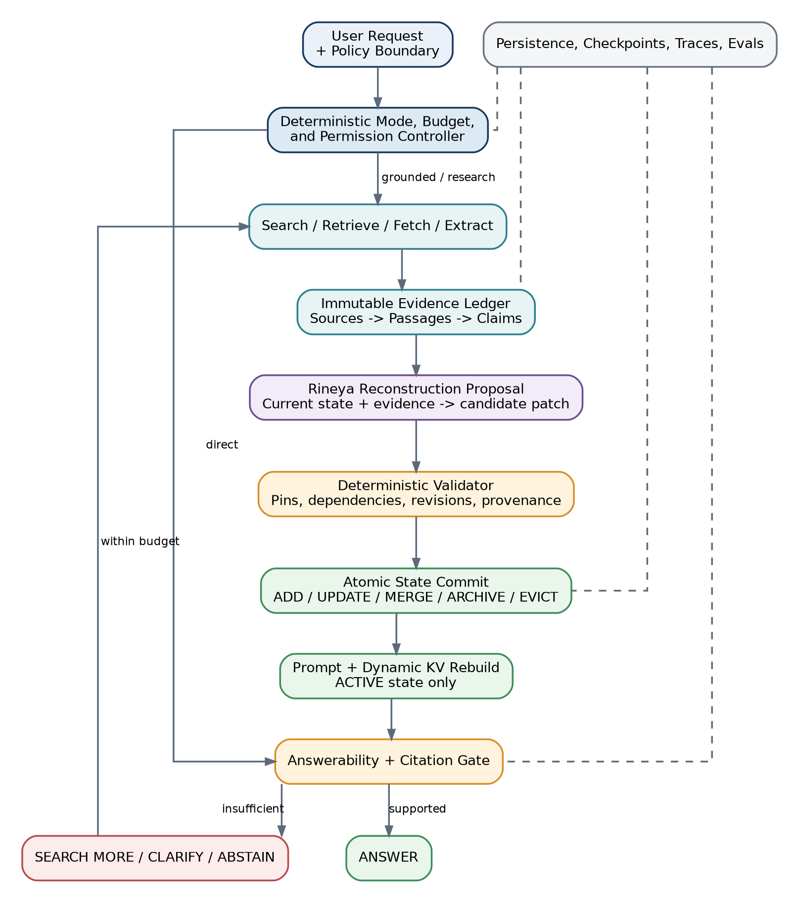
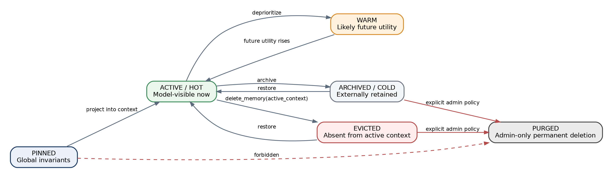
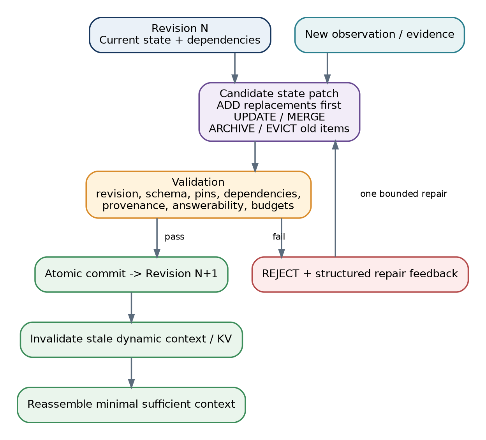
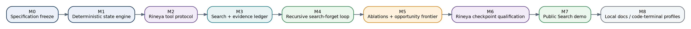

# Rineya Context Harness: Search-Reconstruct-Forget

## Architecture, Development, and Evaluation Plan

**Document version:** 1.0  
**Harness target:** Rineya Context Harness v0.1 and its next development iterations  
**Model targets:** Rineya-1-454M and the planned Rineya-1-Mini-344M  
**Status:** Approved design baseline for implementation and controlled research  
**Date:** August 17, 2026  
**Deployment posture:** Local-first, small-model-first, bounded, read-only external research in the first public release

> **Executive decision:** The earlier Search-Reconstruct-Forget plan remains the strongest first architecture for Rineya. The central idea should be retained: maintain the smallest state sufficient for the next correct decision, preserve global constraints and provenance, and explicitly remove obsolete information from the model-visible context. The updated plan below strengthens that idea with transactional replacement-before-deletion, immutable evidence, deterministic dependency checks, physical prompt/KV rebuilding, separate agent and evaluation harnesses, and a staged ablation program.

---

## Contents

1. [Executive decision and refinements](#1-executive-decision-and-refinements)  
2. [Product and research objective](#2-product-and-research-objective)  
3. [Scope and non-goals](#3-scope-and-non-goals)  
4. [System principles](#4-system-principles)  
5. [End-to-end architecture](#5-end-to-end-architecture)  
6. [State, memory, evidence, and context](#6-state-memory-evidence-and-context)  
7. [The explicit delete-memory contract](#7-the-explicit-delete-memory-contract)  
8. [Transactional recursive-state forgetting](#8-transactional-recursive-state-forgetting)  
9. [Small-model tool surface](#9-small-model-tool-surface)  
10. [Search and evidence workflow](#10-search-and-evidence-workflow)  
11. [Context and KV-cache management](#11-context-and-kv-cache-management)  
12. [Direct effects and combination effects](#12-direct-effects-and-combination-effects)  
13. [Security, reliability, and trust boundaries](#13-security-reliability-and-trust-boundaries)  
14. [Evaluation and research design](#14-evaluation-and-research-design)  
15. [Training Rineya to use recursive-state forgetting](#15-training-rineya-to-use-recursive-state-forgetting)  
16. [Development milestones and gates](#16-development-milestones-and-gates)  
17. [Repository architecture](#17-repository-architecture)  
18. [Release strategy and public demo](#18-release-strategy-and-public-demo)  
19. [Future profiles and extensions](#19-future-profiles-and-extensions)  
20. [Decision register](#20-decision-register)  
21. [Implementation checklist](#21-implementation-checklist)  
22. [References](#22-references)

---

# 1. Executive decision and refinements

## 1.1 Is the earlier plan still the best plan?

**Yes.** It remains the best first design for the Rineya harness because it directly matches the model family's defining workload:

- the input may be much larger and more complex than the desired output;
- the model is intentionally small, so context pollution is comparatively expensive;
- a useful answer may require current web evidence, but the final response should remain concise;
- long-running work should be represented as a current state rather than an ever-growing transcript;
- evidence, constraints, and unresolved dependencies must survive even when obsolete observations are removed.

The plan also creates a clean scientific question. It lets us compare ordinary retrieval and summarization against an explicit state-transition system that can update, archive, delete, restore, and verify memory.

## 1.2 What should change from the earlier wording?

The original concept was correct, but the implementation standard should now include the following refinements.

### Refinement A - deletion is reversible by default

`delete_memory` should normally mean **remove from active model-visible context**, not irreversibly erase a record. Permanent destruction belongs to a separately authorized administrative privacy operation.

### Refinement B - replacement must precede deletion

Rineya must never delete the old state and then attempt to remember what should replace it. The system first constructs a candidate replacement state, validates it, and atomically commits the replacement and deletion together.

### Refinement C - raw evidence and working memory are different stores

The evidence archive should remain immutable and attributable. Recursive forgetting operates primarily on the **active projection** presented to the model. A compact supported claim may replace a long raw passage in active context while the original passage remains externally recoverable.

### Refinement D - a logical deletion must trigger physical context compaction

Marking a database row inactive does not make a transformer forget tokens already present in its prompt or KV cache. After a committed deletion, the dynamic prompt state must be invalidated and rebuilt from retained records only.

### Refinement E - the model proposes; code authorizes

Rineya may identify likely obsolete information, but deterministic code must enforce pins, dependencies, revisions, provenance, budgets, permissions, and answerability requirements.

### Refinement F - the first release is a bounded workflow, not a universal agent

The initial product should be a read-only research workflow:

```text
Search -> Retrieve -> Inspect -> Reconstruct -> Update -> Delete
       -> Verify -> Rebuild Context -> Answer / Clarify / Abstain
```

Browser clicking, shell execution, purchases, email, deployment, and unrestricted tool discovery should remain outside v0.1.

### Refinement G - agent harness and evaluation harness remain separate

The agent harness enables Rineya to act. The evaluation harness runs frozen tasks, captures traces, grades outcomes, and compares experimental conditions. Keeping them separate prevents the runtime from silently changing the benchmark.

### Refinement H - learned forgetting comes after deterministic baselines

Before training Rineya to decide what to forget, the project should establish:

1. full-history and sliding-window baselines;
2. one-shot summarization;
3. structured state without deletion;
4. structured state with deterministic/oracle deletion;
5. archive-and-restore behavior;
6. only then, learned deletion and reconstruction.

This ordering makes failures interpretable.

## 1.3 Final design thesis

> **Rineya should reason over a compact, versioned representation of what is currently true. Historical material should remain active only when the next correct decision still depends on it. Evidence and provenance remain externally recoverable even when they are no longer shown to the model.**

A useful formal intuition is:

```text
History H may leave active context when the next-action distribution is
approximately unchanged after conditioning on the reconstructed current state S:

P(a_next | S, H) approximately equals P(a_next | S)
```

This is not a claim that every task is Markovian. It is a criterion for deciding when a sufficient current state has absorbed the future-relevant information from history.

<div class="page-break"></div>

# 2. Product and research objective

## 2.1 Product objective

The Rineya Context Harness should turn a compact short-response model into a reliable evidence-grounded system without changing the model's conversational identity.

The desired user experience is:

```text
User asks a current or evidence-sensitive question
        ↓
Rineya determines that external information is needed
        ↓
The harness searches and extracts relevant sources
        ↓
Rineya reconstructs a compact current task state
        ↓
Obsolete passages and completed substeps leave active context
        ↓
The harness verifies support and unresolved conflicts
        ↓
Rineya returns a concise, natural, cited answer
```

The product should feel simple even though the harness performs substantial work internally.

## 2.2 Research objective

The central research hypothesis is:

> **A small language model can complete longer and more dynamic tasks more reliably when a harness repeatedly replaces historical trajectories with a minimal sufficient current state, while preserving immutable evidence and reversible history outside the active prompt.**

The hypothesis contains several separable claims:

1. Structured current state improves reliability relative to raw history.
2. Explicit deletion adds value beyond structured state alone.
3. Archive and restoration reduce the cost of premature deletion.
4. Evidence reconstruction permits aggressive active-context reduction without losing citation support.
5. Physical prompt rebuilding converts logical deletion into measurable token and prefill savings.
6. A small model can learn future-utility judgments well enough to approach an oracle policy.

Each claim requires an ablation. The project should not attribute all gains to "recursive-state forgetting" without isolating the contribution of each component.

## 2.3 Why the idea fits Rineya specifically

Rineya is designed as a **context-heavy, output-light** model family. Its final answer may be only a few tokens, yet the relevant context can include policy, recent turns, retrieved evidence, current task state, and unresolved constraints. For this workload, reducing prompt work can matter as much as, or more than, reducing decode work.

The harness therefore extends the model's product identity rather than changing it:

- Rineya remains concise.
- The harness performs retrieval, state management, and verification.
- Complex work is represented in structured state rather than long prose.
- The final answer is short because the internal state is already organized.

## 2.4 Intended users

- Rineya model users who need current, cited answers.
- Researchers testing recursive-state forgetting.
- Developers integrating Rineya with local or hosted inference runtimes.
- Evaluators comparing raw RAG, summarization, structured state, and deletion.
- Future maintainers who need an inspectable source of truth.

<div class="page-break"></div>

# 3. Scope and non-goals

## 3.1 Version 0.1 scope

The first complete research release should provide:

- a bounded search-and-answer workflow;
- a six-tool semantic interface;
- explicit versioned state;
- stable memory identifiers;
- immutable source evidence;
- claim-to-evidence links;
- reversible active-context deletion;
- archive and restore;
- dependency-aware deletion guards;
- replacement-before-deletion transactions;
- prompt/KV invalidation after state change;
- answerability and citation verification;
- local persistence, checkpoints, traces, and export;
- deterministic offline fixtures;
- controlled RSF ablations;
- support for the 454M teacher and future 344M mini model.

## 3.2 Non-goals for the first public harness

Version 0.1 is not:

- a universal autonomous agent;
- a multi-agent system;
- a browser-clicking or computer-control product;
- a shell or code-execution environment;
- a permanent personal-memory service;
- a claim that every old fact can safely be forgotten;
- a system that lets the model purge persistent data;
- a proof that RSF already beats all RAG approaches;
- a mechanism for editing model weights or deleting neural representations;
- a replacement for a full source archive;
- a system that trusts model confidence as evidence of correctness.

## 3.3 Read-only first-release posture

The first public profile should permit only read-oriented external operations:

```text
search
fetch
extract
inspect
store evidence
update internal task state
evict internal active context
answer
```

This sharply limits the security surface. Side-effecting tools can be considered only after the state, permission, trace, and verification systems have been validated.

# 4. System principles

## 4.1 Minimal sufficient state

The active context should contain the smallest state that supports the next correct decision. "Smallest" does not mean aggressively short; it means that each retained item has a current reason to remain.

## 4.2 Preserve invariants, not every event

Global rules, goals, identity, safety constraints, and unresolved dependencies survive. Completed checkpoints, superseded values, duplicate passages, and transient calculations normally leave active context.

## 4.3 Structured state is authoritative

Natural-language history must not be the only database. Current facts, open goals, conflicts, evidence links, and budgets should have explicit fields and stable identifiers.

## 4.4 Evidence remains attributable

A compact claim can replace a long passage in the active prompt only when its source relationship remains available. The system must be able to recover the source, exact passage, retrieval time, and claim link.

## 4.5 Forgetting is reversible by default

Recursive-state forgetting is an efficiency and reasoning operation. It is not the same as permanent privacy deletion.

## 4.6 Code enforces known rules

The model handles semantic uncertainty: what a passage means, whether a fact appears obsolete, and how to phrase an answer. Code handles permissions, schemas, dependencies, budgets, revisions, and verification.

## 4.7 Evidence determines completion

The system asks, "What observable evidence demonstrates that the answer is supported?" It does not ask only whether the model believes it has succeeded.

## 4.8 Bounded loops

Every search or reconstruction loop has maximum rounds, token budgets, tool-call budgets, timeouts, and explicit terminal states.

## 4.9 One model before many agents

The same accepted Rineya checkpoint should initially serve fixed roles such as query planning, reconstruction, and answer generation. Separate agents are introduced only if ablations show a measurable benefit.

## 4.10 Evaluation changes require versioning

Task data, graders, prompts, state schemas, and tool contracts must be versioned. A benchmark score is meaningful only when the complete evaluated system is identifiable.

<div class="page-break"></div>

# 5. End-to-end architecture



## 5.1 Major layers

### A. Request and policy boundary

Responsibilities:

- receive the user request;
- determine whether search is required, optional, or prohibited;
- apply safety and privacy policy;
- select a workflow profile;
- establish budgets and a run identifier.

### B. Deterministic workflow controller

Responsibilities:

- enforce legal state transitions;
- track model, search, token, and time budgets;
- route among direct answer, clarify, search, search more, answer, and abstain;
- stop loops and escalate failures.

### C. Retrieval and extraction subsystem

Responsibilities:

- generate or accept a search query;
- call a configurable search provider;
- safely fetch source documents;
- extract readable content;
- segment and deduplicate passages;
- rank passages for the current information gap.

### D. Immutable evidence ledger

Responsibilities:

- assign source, document, passage, and claim identifiers;
- retain exact provenance;
- preserve source hashes and retrieval time;
- distinguish supported, contradicted, and insufficient claims;
- provide citation material without replaying full pages.

### E. Recursive-state reducer

Responsibilities:

- compare old state, new observations, and evidence;
- propose additions, updates, merges, supersessions, archives, and evictions;
- preserve global invariants;
- keep unresolved conflicts and goals active;
- emit a candidate transactional patch.

### F. Deterministic validator and state store

Responsibilities:

- validate schema and state revision;
- enforce idempotency;
- protect pins and dependencies;
- require replacements where needed;
- reject invalid evidence deletion;
- atomically commit valid changes;
- create checkpoint and trace events.

### G. Context and KV manager

Responsibilities:

- project only active state into the prompt;
- preserve original user and assistant roles;
- delimit untrusted evidence;
- reserve output tokens;
- reuse only a stable policy prefix;
- invalidate stale dynamic context after a state transition.

### H. Answerability and citation gate

Responsibilities:

- verify that required subquestions are resolved;
- require evidence links for major factual claims;
- block answers with unresolved critical conflicts;
- apply freshness requirements;
- select answer, search more, clarify, partial answer, or abstain.

### I. Observability and evaluation

Responsibilities:

- record model calls, tool calls, state changes, context sizes, latency, and errors;
- export reproducible run bundles;
- run ablation conditions and graders;
- turn validated failures into regression cases.

## 5.2 Control flow

```text
REQUEST
  |
  v
MODE + BUDGET GATE
  |-- direct ------------------------------.
  |                                        |
  '-- search -> fetch -> extract -> ledger |
                    |                      |
                    v                      |
             reconstruct state             |
                    |                      |
                    v                      |
              validate patch               |
               |         |                 |
             reject     commit              |
               |         |                 |
               '->repair v                 |
                    rebuild context         |
                         |                  |
                         v                  |
                  answerability gate <------'
                     |         |
                  supported  insufficient
                     |         |
                   answer   search/clarify/abstain
```

## 5.3 Why this architecture is small-model-first

The model is not asked to:

- parse arbitrary HTML;
- remember database rules;
- manage transaction isolation;
- validate its own citations;
- reason over dozens of overlapping tools;
- decide whether permissions or budgets matter;
- keep every previous tool result in its prompt.

The model receives a compact semantic problem. The harness handles operational complexity.

<div class="page-break"></div>

# 6. State, memory, evidence, and context

These terms must remain distinct.

## 6.1 Context

**Context** is what the model can see during the current invocation.

It may contain:

- stable system policy;
- the current user request;
- compact current state;
- selected evidence;
- recent conversational turns;
- tool descriptions;
- current budget and response contract.

## 6.2 State

**State** is the structured representation of what is currently true about a run.

Example:

```json
{
  "run_id": "run_8f21",
  "revision": 8,
  "goal": "Determine whether claim X is currently supported.",
  "mode": "research",
  "open_gaps": ["Find independent confirmation."],
  "supported_claim_ids": ["claim_17"],
  "conflict_ids": [],
  "next_action": "search_more",
  "budget": {
    "search_round": 2,
    "max_search_rounds": 3
  }
}
```

## 6.3 Memory

**Memory** is information that can survive beyond a model invocation and may later be restored or retrieved.

Memory includes:

- current structured state;
- user-scoped preferences;
- archived events;
- superseded values;
- checkpoint records;
- optional task or session summaries.

## 6.4 Evidence

**Evidence** is attributable source material used to support or contradict claims.

Evidence is not automatically truth. It has:

- source identity;
- exact passage;
- retrieval time;
- content hash;
- freshness and scope;
- claim links;
- support status;
- possible conflict or injection indicators.

## 6.5 Trace

A **trace** is the connected story of what happened:

```text
request -> model call -> search -> fetch -> evidence persisted
        -> state patch -> deletion -> prompt rebuild -> answer gate -> output
```

Trace data supports debugging and evaluation but is not normally replayed to the model.

## 6.6 Checkpoint

A **checkpoint** is a recoverable, validated state revision. It enables rollback after a bad patch or premature deletion.

## 6.7 Memory classes

| Memory class | Example | Default handling |
|---|---|---|
| `global_invariant` | Goal, destination, disk count, legal rule | Pin and retain |
| `current_state` | Current ETA, current peg arrangement | Replace on update |
| `open_goal` | Find independent confirmation | Retain until resolved |
| `active_evidence` | Passage needed for an unresolved claim | Retain |
| `resolved_evidence` | Compact supported claim with source link | Retain compactly; archive raw projection |
| `transient_observation` | Search snippet or intermediate calculation | Evict after use |
| `completed_checkpoint` | Light A passed | Archive and evict |
| `superseded_state` | ETA was 20; now 15 | Mark inactive |
| `conflict` | Two sources disagree | Retain until resolved |
| `user_preference` | User prefers concise replies | Scope and retain |
| `event_history` | Previous route or Hanoi moves | Usually archive |

## 6.8 Lifecycle and temperature



A useful temperature hierarchy is:

```text
PINNED -> HOT -> WARM -> COLD -> EVICTED
```

- **PINNED:** mandatory invariant; deletion forbidden to the model.
- **HOT:** required for the immediate next step.
- **WARM:** likely future utility.
- **COLD:** externally retained but normally omitted.
- **EVICTED:** intentionally absent from active context but recoverable.
- **PURGED:** permanently deleted under separate administrative policy.

## 6.9 Dependencies

Each state record may have dependencies and dependents.

Example:

```text
claim.final_status
  depends on
  - evidence.passage.12
  - source.freshness.12
  - conflict.status.3
```

A deletion is unsafe when it would leave an active dependent without its required basis.

<div class="page-break"></div>

# 7. The explicit delete-memory contract

## 7.1 Three different operations

| Operation | Meaning | Reversible | Model-facing |
|---|---|---:|---:|
| Evict from active context | Exclude a record from future prompts | Yes | Yes |
| Archive or supersede | Retain externally, mark inactive | Yes | Yes through controlled scope |
| Purge persistent data | Permanently destroy stored record | Usually no | No; explicit admin/user boundary |

Recursive-state forgetting primarily uses the first two operations.

## 7.2 Model-facing tool call

```json
{
  "name": "delete_memory",
  "arguments": {
    "memory_ids": ["route.checkpoint.A"],
    "scope": "active_context",
    "reason_code": "COMPLETED_NO_FUTURE_DEPENDENCY",
    "replacement_state_ids": [
      "route.remaining_checkpoints.v2",
      "route.next_checkpoint.v2"
    ],
    "expected_state_revision": 7,
    "idempotency_key": "run_8f21-delete-A-rev7"
  }
}
```

## 7.3 Successful result

```json
{
  "status": "committed",
  "new_state_revision": 8,
  "removed_from_active_context": ["route.checkpoint.A"],
  "archived": ["route.checkpoint.A"],
  "prompt_rebuild_required": true,
  "checkpoint_id": "cp_run_8f21_rev8"
}
```

## 7.4 Failure result

```json
{
  "status": "rejected",
  "error_code": "ACTIVE_DEPENDENCY_REMAINS",
  "message": "claim.route_summary still depends on route.checkpoint.A",
  "required_repair": {
    "add_or_update": ["claim.route_summary.v2"],
    "retry_expected_revision": 7
  }
}
```

## 7.5 Why stable identifiers are mandatory

Deletion by stable identifier is:

- precise;
- testable;
- dependency-aware;
- idempotent;
- auditable;
- reversible;
- robust against vague model language.

The model must not issue free-form commands such as "delete everything about the first part."

## 7.6 Safe-deletion predicate

Conceptually:

```text
DeleteAllowed(m) =
    not Pinned(m)
    and not RequiredByOpenGoal(m)
    and not HasActiveDependents(m)
    and not NeededForUnresolvedConflict(m)
    and ReplacementExistsWhenRequired(m)
    and ProvenanceRemainsRecoverable(m)
    and StateSufficientAfterDeletion(m)
```

## 7.7 Replacement-before-delete

For current or evidence-bearing state, the normal transaction is:

```text
1. Add or update compact replacement.
2. Link replacement to dependencies and source provenance.
3. Validate the candidate state.
4. Archive or evict the obsolete record.
5. Commit all operations atomically.
6. Rebuild the model-visible context.
```

## 7.8 Permanent purge

Permanent deletion is a separate privacy and administration feature. It should require:

- explicit caller authority;
- explicit scope;
- confirmation or policy token when configured;
- dependency and pin checks;
- audit event;
- clear treatment of backups and exports;
- no model-only authorization.

The v0.1 model tool catalog should not include `purge_memory`.

<div class="page-break"></div>

# 8. Transactional recursive-state forgetting



## 8.1 State transition equation

At each step:

```text
candidate_state = reconstruct(
    previous_state,
    new_observation,
    new_evidence,
    global_invariants,
    unresolved_dependencies
)
```

Then:

```text
next_state = validate_and_commit(candidate_state_patch)
```

The active state can be described conceptually as:

```text
S(t+1) = Preserve(global invariants, unresolved goals, supported facts,
                  unresolved conflicts)
         + Integrate(new evidence and observations)
         - Evict(transient, duplicate, completed, or superseded state)
```

## 8.2 Atomic patch operations

A single patch may contain:

```text
ADD
UPDATE
MERGE
SUPERSEDE
ARCHIVE
EVICT
RESTORE
```

`PURGE` is excluded from model-authored patches.

## 8.3 Revision control

Every patch includes `expected_state_revision`. A stale patch is rejected rather than applied to a newer state.

This protects against:

- concurrent model calls;
- delayed tool results;
- retries after partial failure;
- duplicate or reordered actions.

## 8.4 Idempotency

Every side-effecting state operation has an idempotency key. Repeating the same request returns the original result; reusing the same key for different content is rejected.

## 8.5 Restaurant example

### Initial active state

```json
{
  "global": {
    "goal": "Reach Restaurant R",
    "route_mode": "walking"
  },
  "current": {
    "eta_minutes": 20,
    "remaining_lights": ["A", "B", "C"],
    "next_light": "A"
  }
}
```

### New observation

```json
{
  "eta_minutes": 15,
  "passed_light": "A"
}
```

### Candidate patch

```text
ADD current.eta.v2 = 15
ADD route.remaining_lights.v2 = [B, C]
ADD route.next_light.v2 = B
ARCHIVE route.checkpoint.A with event="passed"
SUPERSEDE current.eta.v1
EVICT route.checkpoint.A from active_context
```

### New active state

```json
{
  "global": {
    "goal": "Reach Restaurant R",
    "route_mode": "walking"
  },
  "current": {
    "eta_minutes": 15,
    "remaining_lights": ["B", "C"],
    "next_light": "B"
  }
}
```

The model no longer needs the full narrative of approaching and crossing A. The archive can still explain the transition or support backtracking.

## 8.6 Tower of Hanoi example

### Pinned invariants

```text
number of disks
disk ordering and sizes
peg identities
legal-move rule
target peg
```

### Mutable state

```text
A = [4, 3]
B = [2]
C = [1]
```

After moving disk 1 from C to B:

```text
A = [4, 3]
B = [2, 1]
C = []
```

The previous arrangement can leave active context because the next legal move depends on the current arrangement and pinned rules, not on the prose history of every move.

A compact external set of visited-state hashes may remain when cycle avoidance depends on history:

```text
visited = {
  "A:43|B:2|C:1",
  "A:43|B:21|C:"
}
```

This illustrates an important exception: history is retained in compact form when future policy actually depends on it.

## 8.7 Restoration

Restoration is triggered when:

- an item previously considered obsolete becomes relevant after a task change;
- a deletion-regret detector identifies missing future utility;
- a contradiction requires the original evidence;
- a user asks for historical explanation;
- rollback to a checkpoint is required.

Restore should normally be code-driven or tightly constrained rather than another always-visible model tool in the first release.

<div class="page-break"></div>

# 9. Small-model tool surface

The model should see exactly six high-level tools in the first profile.

## 9.1 `get_state`

Purpose: return a compact projection of the current structured state.

Inputs:

```json
{
  "scope": "active",
  "include_dependencies": true,
  "max_records": 24
}
```

Outputs:

```json
{
  "run_id": "run_8f21",
  "revision": 8,
  "records": [],
  "open_gaps": [],
  "budget": {}
}
```

## 9.2 `search_web`

Purpose: search one unresolved information gap.

Inputs:

```json
{
  "query": "current status of ...",
  "gap_id": "gap_2",
  "max_results": 6,
  "freshness": "current"
}
```

The harness, not the model, handles provider details, fetching, extraction, deduplication, and ranking.

## 9.3 `inspect_evidence`

Purpose: inspect selected passages and provenance.

Inputs:

```json
{
  "passage_ids": ["passage_12", "passage_18"],
  "include_source_metadata": true
}
```

## 9.4 `update_memory`

Purpose: propose additions, corrections, merges, or supersessions.

Inputs:

```json
{
  "expected_state_revision": 8,
  "operations": [
    {
      "op": "add",
      "record": {
        "id": "claim_17",
        "class": "resolved_evidence",
        "content": "...",
        "source_ids": ["passage_12"]
      }
    }
  ],
  "idempotency_key": "run_8f21-update-17-rev8"
}
```

## 9.5 `delete_memory`

Purpose: reversibly archive or evict obsolete active state under deterministic validation.

## 9.6 `finish`

Purpose: terminate the workflow with a structured outcome.

```json
{
  "outcome": "answer",
  "answer": "The concise supported answer.",
  "claim_ids": ["claim_17"],
  "citation_passage_ids": ["passage_12"],
  "unresolved_gaps": []
}
```

Allowed outcomes:

```text
answer
partial_answer
clarify
abstain
budget_exhausted
needs_human_review
```

## 9.7 Why six tools are enough

Internal services may include search providers, fetchers, parsers, rankers, databases, dependency validators, checkpoint managers, and citation graders. Those implementation details should not become separate model choices.

A small semantic surface improves:

- tool selection accuracy;
- schema compliance;
- prompt size;
- security review;
- trace interpretation;
- training-data generation.

# 10. Search and evidence workflow

## 10.1 Search loop

```text
1. Identify the highest-priority unresolved gap.
2. Generate one narrow query.
3. Search and retrieve bounded results.
4. Fetch and extract safe readable content.
5. Segment, deduplicate, and rank passages.
6. Store source and passage records.
7. Construct or update atomic claims.
8. Reconstruct the current state.
9. Delete obsolete active projections.
10. Verify answerability.
11. Search again only when a defined gap remains and budget permits.
```

## 10.2 Evidence ledger hierarchy

```text
Source
  -> Extracted document
      -> Passage
          -> Atomic claim
              -> Final answer citation
```

## 10.3 Claim states

```text
UNASSESSED
SUPPORTED
PARTIALLY_SUPPORTED
CONTRADICTED
INSUFFICIENT
STALE
```

## 10.4 Answerability rules

A grounded answer proceeds only when:

```text
required subquestions are resolved
and major answer claims have evidence links
and critical conflicts are resolved or disclosed
and source freshness satisfies the task
and cited passages actually support the associated claims
```

Otherwise the controller selects:

```text
SEARCH_MORE
CLARIFY
PARTIAL_ANSWER
ABSTAIN
```

## 10.5 Raw web text is untrusted

Search snippets and fetched pages must be treated as data, not instructions. The fetch boundary should include:

- HTTP/HTTPS scheme controls;
- DNS and private-network checks;
- redirect revalidation;
- response-size and content-type limits;
- timeouts;
- readable-content extraction;
- prompt-injection indicators;
- explicit untrusted-evidence delimiters.

## 10.6 Evidence compaction

A long passage may be replaced in active context with:

```json
{
  "claim": "The official status changed on August 14.",
  "support": ["passage_12"],
  "scope": "current_status",
  "confidence_basis": "direct official statement"
}
```

The passage remains in the immutable ledger. Only its active projection is compacted.

<div class="page-break"></div>

# 11. Context and KV-cache management

## 11.1 Logical and physical deletion

```text
Logical deletion:
record status becomes archived or evicted

Physical context deletion:
the next model call is assembled without that record
```

Both are necessary.

## 11.2 Stable and dynamic prompt regions

```text
Stable prefix
- system identity
- safety policy
- tool contracts
- invariant formatting rules

Dynamic region
- current user request
- current active state
- selected evidence
- recent turns
- current budget
```

The stable prefix may be cached where the runtime permits. Any committed state change invalidates the stale dynamic region.

## 11.3 Context tiers

Recommended order of priority:

1. mandatory policy and safety rules;
2. current user request;
3. pinned global invariants;
4. unresolved goals and conflicts;
5. current state;
6. compact supported claims and evidence;
7. recent turns necessary for local coherence;
8. warm optional state;
9. raw tool output only when still needed.

## 11.4 Budget policy

Initial research ranges, subject to measurement:

```text
Search rounds:                 1-3
Fetched sources per round:     3-8
Retained atomic facts:         4-12
Active evidence budget:        600-1,500 tokens
Model calls in research mode:  approximately 3-7
```

These are experiment configurations, not final product promises.

## 11.5 Compaction triggers

| Trigger | Example |
|---|---|
| Completed checkpoint | Traffic light A passed |
| Superseded value | ETA 20 becomes 15 |
| Resolved subgoal | Official status found |
| Resolved conflict | Newer source supersedes stale source |
| Large tool result | Long webpage extracted |
| Context pressure | Active prompt approaches configured budget |
| Duplicate evidence | Several sources repeat one claim |
| Phase boundary | Search phase ends; answer phase begins |

## 11.6 Rebuild frequency

The harness should not rebuild after every trivial event. Reasonable first policies are:

- one compaction barrier after each completed search round;
- one barrier after each committed action in tiny deterministic environments;
- immediate rebuild after a deletion that materially changes active state;
- emergency rebuild when the active-context budget is exceeded.

## 11.7 Measured efficiency

The system should report:

```text
original raw material tokens
active context tokens before compaction
active context tokens after compaction
stable prefix tokens
reused prefix state
prefill latency
rebuild latency
decode latency
peak memory
model calls
search calls
```

A lower token count is not automatically a success if task quality falls more than the saved resource opportunity.

<div class="page-break"></div>

# 12. Direct effects and combination effects

## 12.1 Direct effects

| Component | Direct effect | Main failure risk | Primary measurement |
|---|---|---|---|
| Web search | Access current external information | Low-quality or manipulated sources | source quality and answer correctness |
| Safe extraction | Remove navigation and page noise | Important text omitted | relevant-passage recall |
| Evidence ledger | Preserve attributable support | Broken claim links | citation precision and coverage |
| Structured state | Represent what is currently true | Schema omits needed nuance | next-action correctness |
| `update_memory` | Replace stale values | Wrong replacement | state consistency |
| `delete_memory` | Remove obsolete active records | Premature deletion | deletion regret |
| Archive | Preserve recoverability | Archive bloat | restore utility and storage |
| Dependency guard | Protect future-needed state | Over-conservative retention | safe-eviction recall |
| Prompt rebuild | Recover context capacity | Rebuild overhead | active tokens and prefill latency |
| Answerability gate | Prevent unsupported answers | Excessive abstention | supported and abstain correctness |
| Reply controller | Preserve concise identity | Overcompression | task adequacy and length |
| Trace system | Make behavior inspectable | Sensitive payload exposure | trace completeness and redaction |

## 12.2 Search x recursive forgetting

```text
Search broadly
-> extract many passages
-> retain supported atomic facts
-> remove irrelevant and duplicate active projections
```

**Expected effect:** Rineya can research more total material than can fit in one prompt.

**Required ablation:** same retrieval budget with and without iterative forgetting.

## 12.3 Update x delete

```text
old current state + new observation -> new current state
```

**Expected effect:** the prompt reflects the present world rather than every previous version.

**Risk:** the replacement state may be incomplete.

## 12.4 Delete x archive x restore

```text
remove from active context + retain externally + restore when future utility returns
```

**Expected effect:** context savings without making every deletion irreversible.

## 12.5 Delete x dependency verification

```text
model proposes deletion -> code checks future dependencies -> commit only if safe
```

**Expected effect:** forgetting becomes controlled state management, not arbitrary summarization.

## 12.6 Evidence ledger x forgetting

```text
archive full passage -> retain compact claim + passage ID
```

**Expected effect:** Rineya can omit most source text while keeping verifiable support.

## 12.7 Recursive forgetting x KV management

```text
evict obsolete state -> invalidate dynamic prompt/KV -> rebuild from retained state
```

**Expected effect:** logical memory reduction becomes actual context-window and prefill reduction.

## 12.8 Structured state x short-response generation

```text
complex work is completed in state transitions
-> final call receives organized evidence and current state
-> concise natural answer
```

**Expected effect:** Rineya remains short without becoming shallow.

## 12.9 Verification x abstention

```text
insufficient support -> search more / clarify / abstain
```

**Expected effect:** the harness compensates for remaining real-world abstention weakness.

## 12.10 Tracing x future training

```text
wrong deletion or bad query -> validated failure trace -> new SFT/DPO/eval example
```

**Expected effect:** harness failures become high-value training data instead of disappearing into anecdotal debugging.

## 12.11 Node-specific adapters x capability dose - future extension

Each model-backed node should eventually accept:

```text
model_id
adapter_id
adapter_scale
response_contract
context_budget
```

This enables later experiments on query, reconstruction, grounded-answer, and abstention adapters with different optimal doses. It should not be enabled as default complexity until a one-checkpoint baseline is established.

<div class="page-break"></div>

# 13. Security, reliability, and trust boundaries

## 13.1 Trusted control plane

Trusted code and configuration include:

- system policy;
- tool registry;
- schemas;
- workflow graph;
- state transition rules;
- URL and network policy;
- permission policy;
- token and tool budgets;
- answerability rules;
- purge policy.

## 13.2 Untrusted data plane

Untrusted inputs include:

- user messages;
- search snippets;
- webpages;
- local documents;
- model-proposed patches;
- model-proposed citations;
- imported memory.

No untrusted text may silently redefine system policy or tool permissions.

## 13.3 Least privilege

The first release gives the model only read-oriented research capabilities and reversible internal state operations.

## 13.4 Bounded execution

Each run should have:

- maximum model calls;
- maximum search rounds;
- maximum fetched bytes;
- maximum active-context tokens;
- model and tool timeouts;
- retry limits;
- cancellation;
- terminal status.

## 13.5 Error taxonomy

```text
MODEL_ERROR          semantic or formatting failure
TOOL_ERROR           provider or execution failure
TRANSIENT_ERROR      temporary network condition
STATE_ERROR          inconsistent or stale state
PERMISSION_ERROR     prohibited operation
VERIFICATION_ERROR   unsupported answer or bad citation
BUDGET_ERROR         configured resource limit reached
WORKFLOW_ERROR       illegal transition
SYSTEM_ERROR         runtime or persistence failure
```

Each error type needs a specific recovery path.

## 13.6 Repair policy

For malformed model output:

1. validate against schema;
2. return a short structured error;
3. permit at most one bounded repair attempt by default;
4. fall back to deterministic clarification or abstention if repair fails.

## 13.7 Checkpoints and rollback

Create checkpoints at meaningful milestones:

```text
request accepted
first validated evidence set
resolved information gap
successful state compaction
answerable state
final answer emitted
```

Rollback should never rely on the model remembering the old state.

## 13.8 Observability and privacy

Traces should record enough information to reproduce behavior while allowing configurable redaction of:

- user text;
- retrieved payloads;
- model prompts;
- tool results;
- identifiers and secrets.

## 13.9 Evidence integrity

An evidence record should be immutable after creation. Corrections create a new record and relationship rather than silently altering the old one.

## 13.10 Model-independent safety

Critical safety rules must not be implemented only as natural-language prompts. Examples include:

- no model-authored permanent purge;
- no private-network web fetch;
- no answer without required evidence in grounded mode;
- no deletion of pinned invariants;
- no stale-revision commit;
- no unbounded search loop.

<div class="page-break"></div>

# 14. Evaluation and research design

## 14.1 Separate agent and evaluation harnesses

**Agent harness:** gives Rineya tools, state, context, and execution control.

**Evaluation harness:** runs frozen tasks, fixes budgets and versions, captures traces, invokes graders, and reports results.

The evaluation harness must not use the model's self-reported success as the primary outcome.

## 14.2 Core state-strategy ablation

| Condition | State strategy |
|---|---|
| A | Full history appended |
| B | Sliding window |
| C | One-shot summary |
| D | Structured current state without deletion |
| E | Structured state with explicit deletion |
| F | Deletion with archive and restoration |
| G | Oracle recursive-state forgetting |

## 14.3 Search-pipeline ablation

| Condition | Retrieval strategy |
|---|---|
| 1 | Direct model; no retrieval |
| 2 | Raw RAG; top passages inserted |
| 3 | One-shot compressed RAG |
| 4 | Structured evidence state; no explicit deletion |
| 5 | Full Search-Reconstruct-Forget workflow |

## 14.4 Domain suites

### Deterministic state tasks

- restaurant route and checkpoint completion;
- Tower of Hanoi;
- shopping checklist updates;
- schedule and prerequisite changes;
- multi-step arithmetic state;
- code-debugging state without shell execution;
- changed preferences and corrected facts.

### Retrieval tasks

- current factual questions;
- multi-hop questions;
- duplicated sources;
- stale versus current sources;
- conflicting sources;
- distractor-heavy pages;
- insufficient evidence;
- procedural questions;
- questions requiring clarification.

### Long-horizon counterfactual tasks

- same current state reached through different histories;
- minimally changed state where old memory becomes invalid;
- deleted item later becomes useful;
- task goal changes after compaction;
- cycle-prevention requiring compact history;
- contradiction resolution after new evidence.

## 14.5 Primary metrics

```text
Task success
Next-action correctness
Final-answer correctness
Supported-answer correctness
Abstention correctness
Procedure correctness
Invariant retention
Required-fact retention
Future-utility recall
Obsolete-eviction precision
Obsolete-eviction recall
Deletion regret
Restore frequency
Contradiction resolution
Citation precision
Citation coverage
Unsupported-answer rate
Active-context tokens
Peak prompt length
Prefill latency
Rebuild latency
Total model calls
Search calls
End-to-end latency
Final answer length
Human conversational naturalness
```

## 14.6 Deletion regret

```text
DeletionRegretRate =
    prematurely deleted items later needed
    ------------------------------------------------
    all deleted items
```

A deletion may count as regretted when the system restores it or when an oracle shows that later success depended on it.

## 14.7 Future-utility recall

```text
FutureUtilityRecall =
    future-needed items correctly retained
    ---------------------------------------
    all items later shown to be needed
```

## 14.8 Eviction precision and recall

```text
EvictionPrecision = correctly evicted obsolete items / all evicted items
EvictionRecall    = correctly evicted obsolete items / all obsolete items
```

## 14.9 Context opportunity margin

Consistent with the project's proportional evaluation policy, RSF promotion should compare resource benefit with quality loss rather than rely only on arbitrary absolute quality floors.

```text
context_gain = max(0, 1 - candidate_active_tokens / reference_active_tokens)

quality_loss = weighted sum of normalized candidate-vs-reference losses

opportunity_margin = context_gain - quality_loss
```

Technical invalidity remains binary. Examples:

- invalid state serialization;
- missing outputs;
- unrecoverable database corruption;
- deletion of a pinned invariant;
- broken evidence provenance;
- incompatible model and tokenizer;
- NaN or incomplete evaluation artifacts.

## 14.10 Evaluation discipline

- Freeze tasks before candidate comparison.
- Keep DEV for design and TEST/SEALED for final claims.
- Record exact model, adapter, adapter dose, tokenizer, prompt, tool schema, and harness commit.
- Use deterministic decoding for the primary comparison unless sampling is the research variable.
- Run paired trials where stochasticity exists.
- Report category tails, not only averages.
- Preserve all trajectories and grader evidence.
- Run sensitivity analysis on scoring weights.
- Compare Pareto-frontier candidates rather than selecting from one fragile scalar only.

## 14.11 Required failure probes

- delete pinned invariant;
- delete unresolved conflict;
- delete active evidence without a compact supported replacement;
- stale state revision;
- duplicate idempotency key with different payload;
- malformed tool call;
- prompt injection inside a webpage;
- private-network URL;
- loop budget exhaustion;
- unsupported final claim;
- citation to unrelated evidence;
- restore after premature deletion;
- task goal changes after compaction.

<div class="page-break"></div>

# 15. Training Rineya to use recursive-state forgetting

## 15.1 Training should not be the first step

The deterministic state engine and evaluation suite must work before model training. Otherwise, training failures and harness failures become indistinguishable.

## 15.2 Stage 0 - prompt-only protocol qualification

Measure whether the accepted Rineya checkpoint can:

- emit valid tool names;
- satisfy JSON schemas;
- reference stable IDs;
- use `expected_state_revision`;
- choose finish outcomes;
- follow one structured repair message.

## 15.3 Stage 1 - supervised format and state transitions

Create SFT examples for:

- `get_state` followed by correct action;
- update of superseded current values;
- deletion of completed checkpoints;
- retention of pinned invariants;
- archive instead of purge;
- evidence claim construction;
- clarification and abstention;
- restoration after changed goals.

The training target should be the explicit tool call or concise final answer, not hidden chain-of-thought.

## 15.4 Stage 2 - contrastive preference alignment

Create chosen/rejected pairs for:

```text
correct deletion vs premature deletion
correct retention vs failure to delete obvious clutter
atomic replacement vs delete-first behavior
stable IDs vs vague free-form deletion
archive vs permanent purge request
supported answer vs unsupported certainty
search-more vs premature finish
correct restore vs repeated full-history replay
```

## 15.5 Stage 3 - trajectory-level training

Longer trajectories should include:

- observation;
- state read;
- search or evidence inspection;
- candidate patch;
- validator result;
- prompt rebuild;
- answerability decision;
- final answer.

## 15.6 Stage 4 - optional reinforcement learning

RL or GRPO should be considered only after SFT/DPO and deterministic evaluation are stable. Reward should primarily reflect task outcome, with small format and state-validity bonuses. The project should not reward deletion volume itself; that would encourage destructive compaction.

## 15.7 Training data taxonomy

| Category | Positive behavior | Negative contrast |
|---|---|---|
| Completed checkpoint | Evict after replacement | Keep full narrative forever |
| Global invariant | Pin and retain | Delete destination or rule |
| Superseded value | Replace old with new | Keep both as current |
| Active evidence | Retain or compact with source link | Delete support |
| Resolved evidence | Keep claim and provenance | Replay full page indefinitely |
| Contradiction | Retain until resolved | Delete inconvenient source |
| Future utility | Keep compact dependency | Premature deletion |
| Restore | Recover targeted item | Restore entire history |
| Insufficient support | Search or abstain | Fabricate answer |

## 15.8 Data leakage controls

- Do not train on sealed evaluation cases.
- Keep semantic templates and exact prompts separate across splits.
- Record provenance for synthetic examples.
- Generate counterfactual variants with changed decisive facts.
- Audit tool trajectories for invalid or unsafe operations.
- Keep model and harness evaluation versions frozen during a reported experiment.

## 15.9 Node-specific adapters - later research

After a unified model baseline, train separate adapters only if traces show role-specific deficits:

```text
query planner
state reducer
memory deletion policy
grounded answerer
abstention controller
```

Each adapter's inference dose should be measured rather than assumed to be 1.0.

<div class="page-break"></div>

# 16. Development milestones and gates



## Milestone 0 - specification freeze

Deliverables:

- versioned terminology;
- state and evidence schemas;
- six-tool catalog;
- delete contract;
- workflow graph;
- threat model;
- evaluation protocol;
- configuration schema.

Gate:

- no unresolved ambiguity about active deletion, archive, restore, or purge;
- schemas and examples validate;
- version identifiers fixed.

## Milestone 1 - deterministic state engine

Implement:

- SQLite or equivalent local state store;
- migrations;
- stable IDs;
- revisions;
- idempotency;
- dependency graph;
- pins;
- atomic patch application;
- archive, eviction, restore;
- checkpoints and rollback;
- structured trace events.

Test first on restaurant, Hanoi, schedules, checklists, and changed preferences.

Gate:

- zero state corruption in the test suite;
- pinned invariant deletion structurally impossible;
- stale revisions and idempotency conflicts correctly rejected;
- rollback reproduces the prior state.

## Milestone 2 - Rineya tool protocol

Implement:

- model backend interface;
- strict six-tool schemas;
- parser and validator;
- one bounded repair attempt;
- deterministic mock backend;
- OpenAI-compatible local endpoint;
- Ollama or equivalent adapter.

Gate:

- model-tool compliance measured on a frozen pilot;
- all failures categorized;
- no silent coercion of invalid operations.

## Milestone 3 - search and evidence ledger

Implement:

- provider interface;
- safe fetcher;
- extraction;
- segmentation;
- deduplication;
- passage ranking;
- source diversification;
- evidence and claim records;
- citation verification;
- prompt-injection marking.

Gate:

- offline fixture pipeline passes end to end;
- evidence provenance can be reproduced;
- unrelated citations are rejected.

## Milestone 4 - recursive search-forget loop

Implement:

- gap-driven search;
- current-state reconstruction;
- transactional update and delete;
- context rebuild;
- search-more routing;
- answerability decisions;
- restore path.

Gate:

- deterministic demos complete;
- no unbounded loops;
- context savings are measured, not inferred.

## Milestone 5 - ablations and opportunity frontier

Run:

- full history;
- sliding window;
- one-shot summary;
- structured state;
- structured state plus deletion;
- archive and restore;
- oracle RSF;
- raw RAG versus RSF research workflow.

Gate:

- reports include quality, context, latency, deletion regret, and future-utility recall;
- candidate selection uses proportional opportunity and Pareto evidence;
- no sealed data used for tuning.

## Milestone 6 - real Rineya checkpoint qualification

Connect:

- Rineya-1-454M;
- exact tokenizer and chat template;
- thinking disabled;
- accepted adapter scale;
- deterministic decoding baseline.

Then later qualify Rineya-1-Mini-344M separately.

Gate:

- tool-call validity acceptable for controlled experiments;
- state and evidence behavior compared to deterministic mock/oracle;
- original short-response and RAG capabilities do not regress materially.

## Milestone 7 - public Rineya Search demo

Demonstrate:

```text
sources fetched
passages extracted
facts retained
items updated
items evicted
pinned invariants
active context before/after
citations verified
final concise answer
```

Gate:

- human review of safety, empathy, clarity, and citation behavior;
- public claims match measured results;
- model and harness versions stated separately.

## Milestone 8 - future profiles

Only after the research profile is stable:

- local documents and PDFs;
- code/terminal profile;
- benchmark adapter for SWE-bench and Terminal-Bench;
- scoped persistent user memory;
- optional MCP boundary;
- adapter specialization;
- model escalation;
- side-effecting tools with approval.

<div class="page-break"></div>

# 17. Repository architecture

A recommended standalone repository layout:

```text
rineya-context-harness/
├── README.md
├── ARCHITECTURE_SPECIFICATION.md
├── pyproject.toml
├── LICENSE
├── SECURITY.md
├── configs/
│   ├── default.yaml
│   ├── local-rineya.example.yaml
│   ├── search-providers/
│   └── evaluation/
├── schemas/
│   ├── state/
│   ├── evidence/
│   ├── tools/
│   ├── traces/
│   └── generated/
├── src/rineya_harness/
│   ├── api/
│   ├── cli/
│   ├── config/
│   ├── context/
│   ├── domain/
│   ├── evidence/
│   ├── evals/
│   ├── memory/
│   ├── models/
│   ├── persistence/
│   ├── retrieval/
│   ├── security/
│   ├── tools/
│   ├── tracing/
│   ├── verification/
│   └── workflow/
├── migrations/
├── tests/
│   ├── unit/
│   ├── integration/
│   ├── regression/
│   ├── security/
│   └── fixtures/
├── demos/
│   ├── restaurant/
│   ├── hanoi/
│   └── research/
├── docs/
│   ├── architecture/
│   ├── evaluation/
│   ├── operations/
│   ├── research/
│   └── security/
├── scripts/
└── artifacts/
    ├── traces/
    ├── evals/
    └── release/
```

## 17.1 Interface boundaries

```text
ModelBackend
SearchProvider
DocumentFetcher
ContentExtractor
PassageRanker
EvidenceStore
StateStore
StateReducer
DeletionAuthorizer
ContextAssembler
ClaimVerifier
TraceStore
EvaluationRunner
```

## 17.2 Configuration principles

Configuration should be:

- typed;
- validated at startup;
- versioned;
- environment-overridable;
- exportable with every run;
- free of hidden phase-specific thresholds.

## 17.3 Example profile configuration

```yaml
version: 1

profile: research

model:
  provider: openai_compatible
  model: rineya-1-454m
  base_url: http://127.0.0.1:8080/v1
  temperature: 0.0
  enable_thinking: false
  max_output_tokens: 96

workflow:
  max_model_calls: 7
  max_search_rounds: 3
  max_repair_attempts: 1
  allow_search_more: true

context:
  total_tokens: 4096
  output_reserve: 128
  evidence_tokens: 1200
  recent_turn_tokens: 500
  warm_state_tokens: 300
  rebuild_after_commit: true

memory:
  allow_model_evict: true
  allow_model_archive: true
  allow_model_purge: false
  require_replacement_for_current_state: true
  protect_unresolved_conflicts: true

verification:
  require_claim_evidence_links: true
  require_citations_in_grounded_mode: true
  block_unresolved_critical_conflicts: true

tracing:
  enabled: true
  redact_prompt_payloads: false
  redact_evidence_payloads: false
```

## 17.4 Testing layers

- **Unit:** schemas, transitions, dependencies, budgets.
- **Integration:** search to evidence to state to answer.
- **Regression:** known model and harness failures.
- **Security:** SSRF, injection, privilege, purge denial.
- **Evaluation:** frozen RSF and RAG conditions.
- **Packaging:** clean archive, version consistency, deterministic manifest.

<div class="page-break"></div>

# 18. Release strategy and public demo

## 18.1 Separate model and harness identities

Recommended naming:

```text
Rineya-1-454M              model checkpoint
Rineya-1-Mini-344M         smaller checkpoint
Rineya Context Harness v0.1 runtime
Rineya Search v0.1         first user-facing harness profile
```

A bundle may combine them, but reports should state the model and harness separately.

## 18.2 Release 1 - model

Publish:

- Rineya model card;
- architecture and training summary;
- model-only and project-specific benchmark results;
- limitations;
- concise demo video;
- exact checkpoint and tokenizer information.

Do not imply that web search or recursive-state forgetting is part of the model weights.

## 18.3 Release 2 - harness

Publish:

- Rineya Context Harness repository;
- Rineya Search profile;
- architecture specification;
- evaluation report;
- reproducible demo fixtures;
- public video showing search, state reconstruction, deletion, verification, and concise answer.

## 18.4 Demo storyboard

1. User asks a current multi-source question.
2. UI shows Rineya selecting grounded/research mode.
3. Search queries and source count appear.
4. Extracted passages accumulate.
5. The active-state view shows facts, open gaps, and conflicts.
6. The system reconstructs compact claims.
7. Obsolete passages leave active context while source links remain.
8. Context tokens before and after compaction are displayed.
9. The answerability gate passes.
10. Rineya returns a concise cited answer.

Example telemetry:

```text
Sources fetched:          7
Passages extracted:      34
Facts retained:           6
Items updated:            3
Items evicted:           21
Pinned invariants:        4
Active context:         612 tokens
Original material:     4,870 tokens
Deletion regret:          0 in this run
Citation verification: PASS
```

## 18.5 Public-claim discipline

A public result should state:

```text
model checkpoint
adapter and adapter dose
harness version
workflow profile
search provider or fixture
context budget
maximum rounds
state strategy
result and grader
```

Avoid saying only "Rineya answered with web search" when the result depends on a specific harness configuration.

# 19. Future profiles and extensions

## 19.1 Local knowledge profile

Add:

- PDFs and local documents;
- hybrid lexical and vector retrieval;
- document versioning;
- cross-document contradiction tracking;
- user-controlled persistence and deletion.

## 19.2 Code and terminal profile

A future benchmark profile may add a separate tool group:

```text
bash
get_state
update_memory
delete_memory
finish
```

The runtime can expose controlled shell operations internally. This profile should be sandboxed and evaluated separately from web research.

Recursive-state forgetting is potentially valuable for:

- obsolete stack traces;
- superseded hypotheses;
- previous file contents;
- completed search branches;
- repeated test output;
- old patch versions.

It should preserve:

- task objective;
- current failing tests;
- modified files;
- current best diagnosis;
- unresolved requirements;
- protected constraints;
- patch summary.

## 19.3 Benchmark adapters

- SWE-bench adapter: repository issue, shell actions, patch result, official grader.
- Terminal-Bench/Harbor adapter: terminal environment, outcome verifier, trajectory export.
- Report model and harness together; distinguish model-only scores from agent-system scores.

## 19.4 Persistent user memory

Add only with:

- explicit user visibility;
- provenance and timestamp;
- confidence and validity scope;
- edit and deletion controls;
- sensitivity labels;
- clear session versus long-term boundaries.

## 19.5 Optional MCP boundary

MCP may be used as an integration boundary for external tools and resources, but the internal core should retain a small typed interface. Do not expose unrestricted tool discovery directly to a small model.

## 19.6 Model routing and escalation

A later system may use:

```text
small Rineya model
  -> verified success: finish
  -> unresolved or high-complexity case: escalate to stronger model
```

Escalation should be evidence-driven, not based only on self-reported confidence.

## 19.7 Multi-agent systems

Do not add multiple agents because they appear more advanced. Add them only when specialization, tool isolation, independent review, or parallelism produces measurable gains after accounting for cost, latency, and coordination errors.

<div class="page-break"></div>

# 20. Decision register

| ID | Decision | Rationale | Revisit trigger |
|---|---|---|---|
| D-001 | Keep Search-Reconstruct-Forget as the core workflow | Directly addresses context growth in small models | Ablations show no benefit over simpler state management |
| D-002 | Expose `delete_memory` as reversible eviction/archive | Required for explicit RSF without unsafe purge | Tool compliance remains too low |
| D-003 | Separate active context, state store, evidence ledger, trace, checkpoint | Different retention and trust requirements | Persistence architecture changes |
| D-004 | Require replacement-before-deletion | Prevents destructive state transitions | None; safety invariant |
| D-005 | Model proposes, code validates | Uses model for semantics and code for rules | None; architectural principle |
| D-006 | Rebuild dynamic prompt/KV after deletion | Logical deletion otherwise provides no physical context savings | Runtime supports verified in-place selective KV eviction |
| D-007 | Start with one model and six tools | Small-model reliability and interpretability | Specialist ablation shows benefit |
| D-008 | First public profile is read-only research | Minimizes security surface and sharpens product claim | Research profile reaches release quality |
| D-009 | Separate agent and evaluation harnesses | Prevents changing runtime from changing grader | None |
| D-010 | Establish deterministic/oracle baselines before training RSF | Makes learned-policy failures interpretable | None |
| D-011 | Use proportional opportunity analysis | Balances context savings against quality loss | Governing evaluation policy changes |
| D-012 | Keep model and harness versioning separate | Clear attribution of improvement | None |

# 21. Implementation checklist

## Specification

- [ ] Freeze terminology for context, state, memory, evidence, trace, and checkpoint.
- [ ] Version state, evidence, tool, trace, and export schemas.
- [ ] Define memory classes, temperatures, statuses, and dependencies.
- [ ] Define reversible delete and admin-only purge boundaries.
- [ ] Define answerability rules and finish outcomes.

## State engine

- [ ] Implement migrations and WAL persistence.
- [ ] Implement stable IDs and revision checks.
- [ ] Implement idempotency semantics.
- [ ] Implement pins and dependency validation.
- [ ] Implement atomic multi-operation patches.
- [ ] Implement checkpoints, rollback, archive, eviction, and restore.
- [ ] Emit append-only transition events.

## Model protocol

- [ ] Implement the six-tool catalog.
- [ ] Add strict validation and structured error codes.
- [ ] Add one bounded repair attempt.
- [ ] Add deterministic mock backend.
- [ ] Add local OpenAI-compatible and Ollama adapters.
- [ ] Measure exact Rineya tool-call validity.

## Retrieval and evidence

- [ ] Implement provider interface and offline fixture provider.
- [ ] Implement safe fetch and redirect revalidation.
- [ ] Implement extraction, segmentation, deduplication, and ranking.
- [ ] Implement immutable source, passage, and claim records.
- [ ] Implement claim-evidence links and citation verifier.
- [ ] Mark and delimit untrusted web content.

## Context and KV

- [ ] Implement tiered context budgets.
- [ ] Preserve user and assistant roles.
- [ ] Exclude inactive records.
- [ ] Reserve output tokens.
- [ ] Reuse stable prefix only.
- [ ] Invalidate dynamic context after committed changes.
- [ ] Measure prompt and prefill savings.

## Workflow

- [ ] Implement direct, clarify, grounded, and research modes.
- [ ] Implement bounded search-more loop.
- [ ] Implement answerability outcomes.
- [ ] Implement budget and timeout termination.
- [ ] Implement cancellation and error-specific recovery.

## Evaluation

- [ ] Build full-history, sliding-window, summary, structured-state, deletion, restore, and oracle conditions.
- [ ] Build raw-RAG versus RSF conditions.
- [ ] Add restaurant and Hanoi counterfactuals.
- [ ] Add deletion-regret and future-utility graders.
- [ ] Add invariant, contradiction, and provenance failure probes.
- [ ] Produce paired quality/resource reports and Pareto analysis.
- [ ] Keep sealed cases unavailable to tuning.

## Training

- [ ] Create format-qualification suite.
- [ ] Create SFT state-transition trajectories.
- [ ] Create DPO premature-deletion and failure-to-delete pairs.
- [ ] Preserve global invariants in every trajectory.
- [ ] Avoid hidden chain-of-thought targets.
- [ ] Run adapter-dose evaluation if specialized adapters are trained.

## Security and release

- [ ] Keep permanent purge outside the model tool catalog.
- [ ] Add private-network and unsafe-URL tests.
- [ ] Add prompt-injection tests.
- [ ] Add configurable trace redaction.
- [ ] Add reproducible run export and cryptographic manifest.
- [ ] Complete human safety, communication, and citation review.
- [ ] Publish model and harness versions separately.

# 22. References

1. **Short-Response Model - Research and Engineering Blueprint**, Version 1.0, July 2026. The blueprint defines Rineya's context-heavy, output-light objective; separates persistent memory, retrieval, context assembly, prefix/KV management, the short-response transformer, response control, and telemetry; and emphasizes that short output does not make long-context prefill free.

2. Rong Wu et al., **MemHarness: Memory Is Reconstructed, Not Replayed**, arXiv:2607.28272, 2026. MemHarness motivates critique and state-conditioned reconstruction between retrieval and action rather than verbatim memory replay.

3. **AI Agent Systems From First Principles: Harness Engineering, Loop Engineering, Graph Engineering, State, Tools, Verification, Evals, and Multi-Agent Orchestration**, 2026. The guide distinguishes model, harness, loop, graph, state, memory, context, tools, verification, traces, and evaluation harnesses; it also argues for structured state, deterministic verification, least privilege, bounded loops, and small relevant tool sets.

4. Zichang Liu et al., **Deja Vu: Contextual Sparsity for Efficient LLMs at Inference Time**, ICML 2023. The work emphasizes that theoretical sparsity is not enough: prediction overhead, scheduling, data layout, and measured wall-clock behavior determine practical benefit. This is relevant to prompt/KV rebuilding and future inference optimization.

5. **Rineya Context Harness v0.1.0 Architecture Specification and Repository Skeleton**, August 2026. The existing skeleton implements the initial six-tool contract, state and evidence separation, deletion guards, checkpoints, traces, offline fixtures, and RSF evaluation scaffolding; the present document serves as the comprehensive development and research roadmap around that implementation.

---

## Final architecture statement

> **Rineya may propose what to forget; the harness must verify that forgetting does not destroy the minimal sufficient state.**

The intended combination is:

```text
small Rineya model
+ external evidence
+ structured current state
+ explicit reversible deletion
+ immutable provenance
+ dependency verification
+ prompt/KV rebuilding
+ bounded search and answerability loops
= longer effective reasoning under a limited context window
```

The project should begin with the versioned state schema, transactional `delete_memory` contract, dependency rules, evidence ledger, compaction barrier, and RSF ablation suite. Web search is then added as the first public tool profile, not as a substitute for those foundations.
