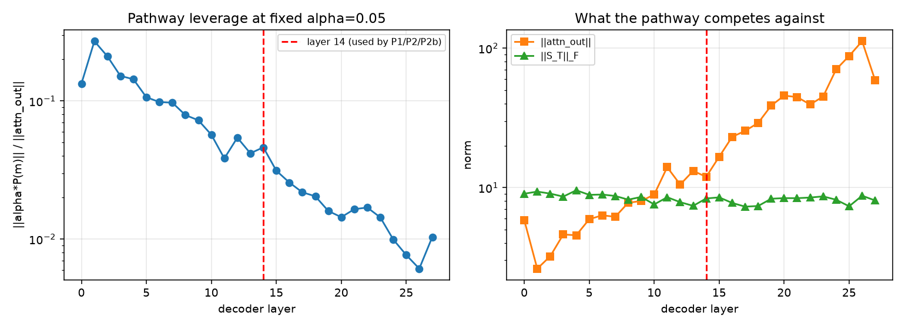

# Layer probe (brief section 6, partial)

Zero-training sweep over all 28 decoder layers. Produced by
`scripts/probe_layers.py`; raw numbers in
`artifacts/supa_a1_1_fast_weight_attention_v1/diagnostics/layer_probe.json`.
Cost: ~90 seconds, against ~9 GPU-hours for the trained sweep it replaced
(`PREREGISTRATION.md` Amendment 10).

Each layer gets an untrained block at fixed `alpha = 0.05` with the **same**
random projection `P` (seed 7), so only the layer's own hidden statistics differ.

## Result: the profile is strongly peaked, and the reason is mundane

| | layer | value |
|---|---:|---:|
| highest leverage | **1** | 0.2702 |
| lowest leverage | 26 | 0.0061 |
| **layer 14** (used by P1/P2/P2b) | 14 | **0.0462** — rank **13 of 28** |
| spread | | **44x** |

Leverage falls monotonically with depth. The cause is visible in the second
panel: **`||attn_out||` grows 43x** from layer 0 to layer 26 (5.8 -> 112.5),
while the recurrent state norm `||S_T||_F` is essentially flat (7.3-9.5, a 1.3x
range). The pathway's own output is roughly scale-stable across depth; what
changes is the size of the residual stream it is added to.

So this is **not** evidence that early layers represent something more amenable
to fast-weight memory. It is the trivial statement that a fixed-size perturbation
is a larger fraction of a smaller vector.

## The caveat that limits what this can decide

**`alpha` is trained, so leverage at fixed alpha is compensable.** A deep layer
could in principle reach the same relative influence by learning a larger alpha.
The probe does not measure whether a layer is a *better place for memory*; it
measures the scale the pathway starts out fighting.

It becomes actionable only through the optimisation budget. In P2b, trained alpha
moved from 0.05 to 0.07-0.10 in 100 steps — Adam bounds total movement by
`steps * lr = 0.1`. Matching layer 1's relative influence at layer 24 would need
alpha near 1.0, roughly **19x beyond what this budget can reach**. Under the P2b
training recipe, deep placements are therefore handicapped by the optimiser, not
by the architecture.

## What this establishes, and what it does not

**Establishes**
- Layer 14 was a middling choice by leverage (rank 13 of 28), not a good one.
- The leverage profile across depth is dominated by residual-stream norm growth.
- The recurrent state accumulates near-identically at every depth, so nothing
  about *where* the memory is placed changes how much it stores.

**Does not establish**
- That an early layer would produce a better trained result. Leverage is not
  benefit, and alpha is learnable.
- Anything about the C-vs-B contrast at any placement. No arm was trained here.

## Why the trained sweep was not run

It would have reused the P2b suite, on which the trained control already scores
159/168. Amendment 3 requires 6 clean discordant wins for significance and P2b's
measured C-vs-B discordance was 3 and 4 in total, so four nulls were close to
certain regardless of whether placement matters — Amendment 6's compressed-range
defect, inherited by reusing the same instrument.

**The prerequisite for a meaningful trained sweep is a suite calibrated against a
trained control, not against the frozen backbone.** That is the correction
Amendment 6 identified and it has not been done. Running placements first would
repeat the error at four times the cost.

## Recommended next experiment, if the question is still worth money

1. Rebuild the suite so a *trained* arm B lands near 0.6-0.8, not 0.95. Calibrate
   against arm B, which costs one training run per candidate difficulty.
2. Only then sweep placement, with alpha init or learning rate scaled per layer
   so deep placements are not handicapped by the optimiser rather than by depth.
3. Two seeds minimum, given how much seed variance the interference battery
   showed.

Absent step 1, no placement result will be interpretable.
