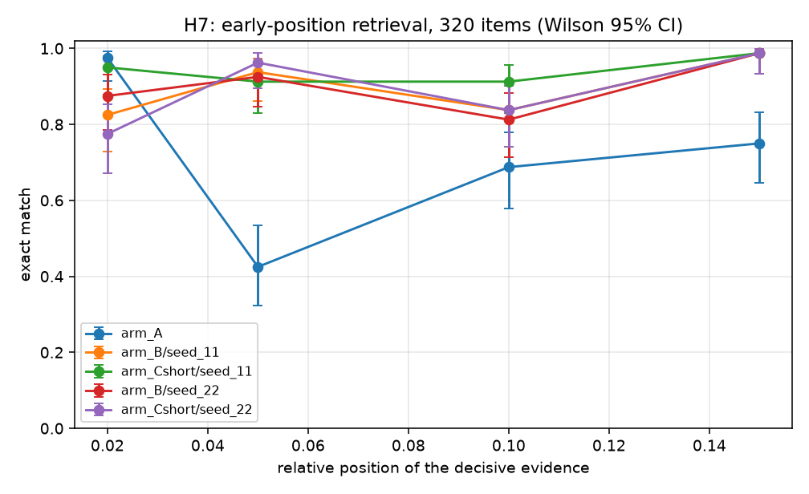

# Results — H7, early-position retrieval

Preregistered in `PREREGISTRATION.md` Amendments 11 and 12.
Classification: **EXPLORATORY**. See the caveat at the bottom — this is not a
confirmatory result and two seeds do not make it one.

**H7.** Short-horizon recurrent memory (arm C-short) improves early-position
retrieval over the parameter-matched static control (arm B).

Suite: 320 items, positions [0.02, 0.05, 0.1, 0.15], lengths [2048, 4096], two-hop
`vault -> unit -> code`, 24 confusable decoys, fresh eval seed 808. No arm was
retrained; the adapters come from P2b and the training split is disjoint from
every eval suite by construction.

## Totals

| Arm | exact [95% CI] |
|---|---|
| A | 227/320 = 0.7094 [0.657,0.756] |
| B s11 | 287/320 = 0.8969 [0.859,0.926] |
| Cshort s11 | 301/320 = 0.9406 [0.909,0.962] |
| B s22 | 288/320 = 0.9000 [0.862,0.928] |
| Cshort s22 | 285/320 = 0.8906 [0.852,0.920] |

## Primary contrast — paired two-sided exact McNemar, within seed, all 320 items

| Seed | C-short better | B better | discordant | p |
|---|---:|---:|---:|---:|
| 11 | 18 | 4 | 22 | 0.00434 **sig** |
| 22 | 8 | 11 | 19 | 0.64761 |

**Criterion fixed before the run: p < 0.05 at BOTH seeds.**
**Verdict: H7 NOT SUPPORTED.**

## By position (descriptive: B -> C-short of cell, with discordant counts)

| Seed | 0.02 | 0.05 | 0.10 | 0.15 |
|---|---|---|---|---|
| 11 | 66->76 /80 (10/0) | 75->73 /80 (2/4) | 67->73 /80 (6/0) | 79->79 /80 (0/0) |
| 22 | 70->62 /80 (1/9) | 74->77 /80 (3/0) | 65->67 /80 (4/2) | 79->79 /80 (0/0) |

## By context length (descriptive)

| Seed | 2048 | 4096 |
|---|---|---|
| 11 | 145->153 /160 (10/2) p=0.039 | 142->148 /160 (8/2) p=0.109 |
| 22 | 149->144 /160 (1/6) p=0.125 | 139->141 /160 (7/5) p=0.774 |

## What this does and does not establish

**Does**, if supported: on a synthetic two-hop retrieval task at layer 14, a
bounded rank-16 recurrent state with an 87.5-token retention horizon recovers
early-position items that a parameter-matched static pathway does not.

**Does not**
- Overturn the P2b NO-GO. That contrast (C vs B over all positions, long horizon)
  was null at both seeds and stands.
- Show any efficiency benefit. Peak VRAM is unchanged, prefill is 1.5-4.2x
  slower, and an auxiliary design cannot convert a bounded state into a memory
  saving because full attention still runs.
- Generalise past layer 14, past this synthetic task, or to the long horizon.

## Why this is exploratory even at two seeds

The early-position effect was **found by mining P2b's residuals**, and this suite
was then built to oversample exactly where the effect had been seen. That is a
sound way to generate a hypothesis and an unsound way to confirm one. The two
seeds share the same 320 items, so they are not independent replications
(Amendment 9) and their p-values are not combined.

A confirmatory result needs a fresh suite, a third seed, and the analysis fixed
before the data is seen.

---

## The mechanism behind the non-replication: recurrence adds variance, not signal

The two arms differ sharply in how stable they are across training seeds.

| | seed 11 | seed 22 | spread | discordant s11 vs s22 |
|---|---:|---:|---:|---:|
| B (static control) | 287/320 | 288/320 | **1 item** | 15 |
| C-short (recurrent) | 301/320 | 285/320 | **16 items** | 28 |

Arm B lands in the same place regardless of seed. Arm C-short moves 16 items and
disagrees with itself on 28 of 320 — nearly twice arm B's self-disagreement.

The by-position breakdown shows where the instability lives (C-short minus B, in
items):

| seed | 0.02 | 0.05 | 0.10 | 0.15 |
|---|---:|---:|---:|---:|
| 11 | **+10** | −2 | +6 | 0 |
| 22 | **−8** | +3 | +2 | 0 |

Position 0.02 — the earliest, hardest cell and the one that drove seed 11's
significance — swings from **+10 to −8** across seeds, an 18-item reversal in a
single 80-item cell.

So the seed-11 result was not a small effect that failed to replicate. It was
**seed variance in the recurrent arm landing favourably**, and the same variance
landed unfavourably at seed 22. Adding a recurrent state to this pathway makes
the trained outcome less reproducible without making it better.

## Why the two-seed criterion earned its keep

At seed 11 alone this reads as a clean win: +14 items, 18/4 discordant,
p = 0.0043, on a properly powered instrument, in the exact regime theory
predicted. Reported at that point it would have been a **false positive**, and a
persuasive one.

Two guards caught it, both fixed before the data existed: the criterion required
p < 0.05 at **both** seeds (Amendment 12), and the finding was labelled
exploratory-by-construction because the suite was built to oversample where the
effect had already been seen (Amendments 11-12).

The step-0 replication that justified building this suite — 4/0 and 5/0 across
seeds, zero losses in 9 discordant pairs — was itself the same illusion at
smaller scale. Small discordant counts on a 48-item subset looked like strict
dominance; at 320 items the arm loses 4 and then 11 items.

## Status of H7

**Rejected.** Short-horizon recurrent memory does not reliably improve
early-position retrieval over a parameter-matched static control at layer 14. The
P2b NO-GO is unaffected and stands.
