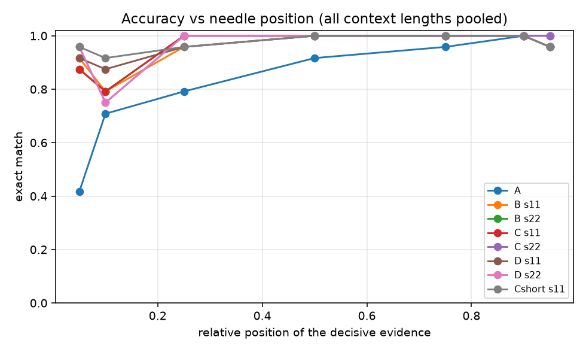
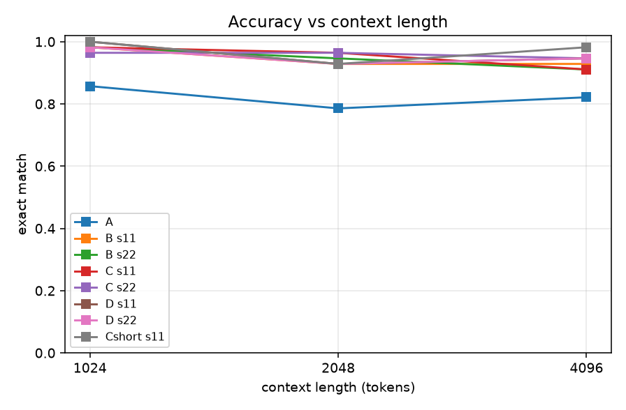
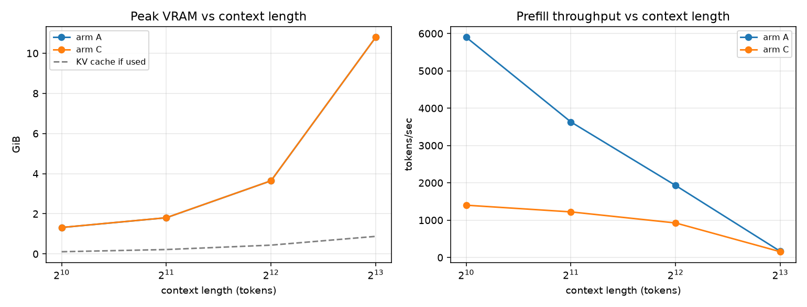

# Results — P2b (long-context, non-ceilinged suite)

Classification: `EXPLORATORY_NOT_CONFIRMATORY`. Preregistered in
`PREREGISTRATION.md` Amendment 1. Generated by `scripts/make_report.py`.

Suite: two-hop `vault -> unit -> code`, 24 confusable decoys,
token-exact lengths [1024, 2048, 4096], 8 items per
(length, position) cell, 32 candidates from a 552-code single-token answer
space, scored by candidate argmax in one forward pass.
Seeds [11, 22]. Layer 14, rank 16.

## Aggregate

| Arm | n | exact [95% CI] | middle | edge | middle−edge | interference |
|---|---:|---|---:|---:|---:|---|
| A | 168 | 0.821 [0.76,0.87] | 0.889 | 0.771 | +0.118 | 0.982 [0.91,1.00] |
| B s11 | 168 | 0.946 [0.90,0.97] | 0.986 | 0.917 | +0.069 | 0.982 [0.91,1.00] |
| B s22 | 168 | 0.946 [0.90,0.97] | 1.000 | 0.906 | +0.094 | 0.911 [0.81,0.96] |
| C s11 | 168 | 0.952 [0.91,0.98] | 1.000 | 0.917 | +0.083 | 0.893 [0.79,0.95] |
| C s22 | 168 | 0.958 [0.92,0.98] | 1.000 | 0.927 | +0.073 | 0.821 [0.70,0.90] |
| D s11 | 168 | 0.958 [0.92,0.98] | 0.986 | 0.938 | +0.049 | 0.982 [0.91,1.00] |
| D s22 | 168 | 0.952 [0.91,0.98] | 1.000 | 0.917 | +0.083 | 0.911 [0.81,0.96] |
| Cshort s11 | 168 | 0.970 [0.93,0.99] | 0.986 | 0.958 | +0.028 | 0.982 [0.91,1.00] |

## Accuracy by needle position

**exact match at each relative position**

| Arm | 0.05 | 0.1 | 0.25 | 0.5 | 0.75 | 0.9 | 0.95 |
|---|---|---|---|---|---|---|---|
| A | 0.417 | 0.708 | 0.792 | 0.917 | 0.958 | 1.000 | 0.958 |
| B s11 | 0.917 | 0.792 | 0.958 | 1.000 | 1.000 | 1.000 | 0.958 |
| B s22 | 0.875 | 0.792 | 1.000 | 1.000 | 1.000 | 1.000 | 0.958 |
| C s11 | 0.875 | 0.792 | 1.000 | 1.000 | 1.000 | 1.000 | 1.000 |
| C s22 | 0.958 | 0.750 | 1.000 | 1.000 | 1.000 | 1.000 | 1.000 |
| D s11 | 0.917 | 0.875 | 0.958 | 1.000 | 1.000 | 1.000 | 0.958 |
| D s22 | 0.958 | 0.750 | 1.000 | 1.000 | 1.000 | 1.000 | 0.958 |
| Cshort s11 | 0.958 | 0.917 | 0.958 | 1.000 | 1.000 | 1.000 | 0.958 |

## Accuracy by context length

**exact match at each context length**

| Arm | 1024 | 2048 | 4096 |
|---|---|---|---|
| A | 0.857 | 0.786 | 0.821 |
| B s11 | 0.982 | 0.929 | 0.929 |
| B s22 | 0.982 | 0.946 | 0.911 |
| C s11 | 0.982 | 0.964 | 0.911 |
| C s22 | 0.964 | 0.964 | 0.946 |
| D s11 | 1.000 | 0.929 | 0.946 |
| D s22 | 0.982 | 0.929 | 0.946 |
| Cshort s11 | 1.000 | 0.929 | 0.982 |

## Interference battery (A–G)

| Arm | A | B | C | D | E | F | G |
|---|---|---|---|---|---|---|---|
| A | 1.00 | 0.88 | 1.00 | 1.00 | 1.00 | 1.00 | 1.00 |
| B s11 | 1.00 | 0.88 | 1.00 | 1.00 | 1.00 | 1.00 | 1.00 |
| B s22 | 1.00 | 0.88 | 1.00 | 1.00 | 1.00 | 0.50 | 1.00 |
| C s11 | 1.00 | 0.88 | 0.88 | 1.00 | 1.00 | 0.50 | 1.00 |
| C s22 | 1.00 | 0.62 | 0.88 | 1.00 | 1.00 | 0.25 | 1.00 |
| D s11 | 1.00 | 0.88 | 1.00 | 1.00 | 1.00 | 1.00 | 1.00 |
| D s22 | 1.00 | 0.88 | 1.00 | 1.00 | 1.00 | 0.50 | 1.00 |
| Cshort s11 | 1.00 | 0.88 | 1.00 | 1.00 | 1.00 | 1.00 | 1.00 |

## Preregistered contrasts (paired two-sided exact McNemar)

In each row, "b better" counts items the second arm got right and the first got
wrong. `C_vs_B` has a=B, b=C, so "b better" is arm C winning.

| Contrast | n paired | b better | a better | discordant | p (two-sided exact) |
|---|---:|---:|---:|---:|---:|
| C_vs_A_seed11 | 168 | 25 | 3 | 28 | 0.0000 |
| C_vs_B_seed11 | 168 | 2 | 1 | 3 | 1.0000 |
| D_vs_C_seed11 | 168 | 3 | 2 | 5 | 1.0000 |
| C_vs_A_seed22 | 168 | 26 | 3 | 29 | 0.0000 |
| C_vs_B_seed22 | 168 | 3 | 1 | 4 | 0.6250 |
| D_vs_C_seed22 | 168 | 2 | 3 | 5 | 1.0000 |
| Clong_vs_Cshort | 168 | 2 | 5 | 7 | 0.4531 |

## Training

| Run | steps | first loss | last loss | final alpha | GPU-h | peak VRAM |
|---|---:|---:|---:|---:|---:|---:|
| arm_B/seed_11 | 100 | 0.0029 | 0.0011 | 0.09870 | 0.484 | 3.19 GiB |
| arm_C/seed_11 | 100 | 0.0029 | 0.0002 | 0.06960 | 0.548 | 3.18 GiB |
| arm_D/seed_11 | 100 | 0.0029 | 0.0004 | 0.06768 | 0.562 | 3.19 GiB |
| arm_B/seed_22 | 100 | 0.0252 | 0.0031 | 0.10145 | 0.678 | 3.19 GiB |
| arm_C/seed_22 | 100 | 0.0252 | 0.0004 | 0.07014 | 0.650 | 3.18 GiB |
| arm_D/seed_22 | 100 | 0.0252 | 0.0002 | 0.06997 | 0.638 | 3.19 GiB |
| arm_Cshort/seed_11 | 100 | 0.0029 | 0.0004 | 0.07617 | 0.640 | 3.18 GiB |

Total training GPU-hours: 4.200

## Resources

Figures written: accuracy_vs_position.png, accuracy_vs_length.png, resources_vs_length.png
