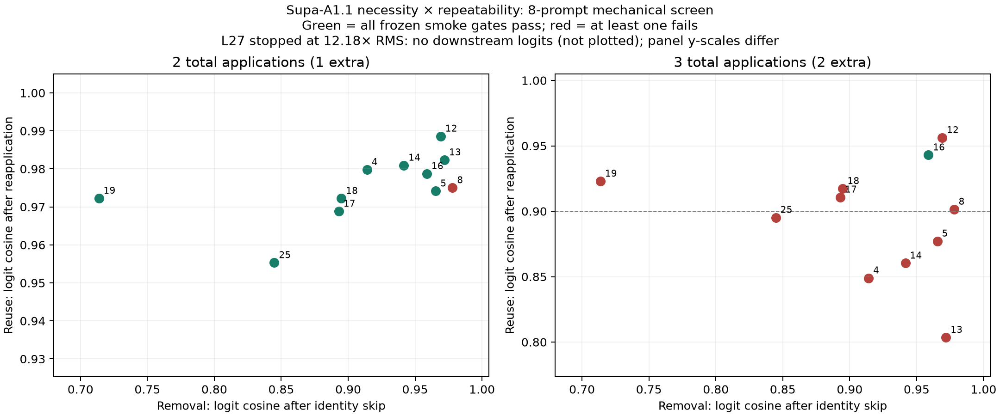

# ARMR research checkpoint

Status: **mechanically qualified shallow middle reuse; development efficacy
INCONCLUSIVE; adaptive escalation closed**.

Supa-A1.1 tolerates one extra application of many tested middle layers under
the eight-prompt screen. That tolerance neither implies useful refinement nor
extends reliably to another extra pass. The last-layer control is qualitatively
different: L27 repeat-2 triggered a 12.18x hidden-RMS increase and stopped before
downstream logits or generation. No canonical model parameters or checkpoint
files changed. No training or sealed evaluation occurred.

## Repository and setup

- Repository: ChatBubble-cross-scale (ChatBubble GitHub repository).
- Research branch: `research/supa-a1.1-anchor-routed-middle-recurrence-v1`.
- Starting clean HEAD / historical ablation evidence: `fde553c908db39e87a15a52ed239d1ba0a68bfd3`.
- Protocol/audit freeze: `df03f36`; original executable screen harness: `fb7e220`.
- Fixed implementation and its executable run: `251bb46`.
- The current branch HEAD includes subsequent interpretation fixes and reports;
  each run's manifest identifies its exact execution commit and source hashes.
- Checkpoint: Supa-A1.1 1.1.0-devfreeze, custom `Qwen3AbstainForCausalLM` with
  the published UNKNOWN logit offset retained, 28 layers, hidden size 1024.
- Weight SHA256: `a99f079d32212bbcbb703c2e2bad801ea32d43afea52004f38bf94eec5dc4026`.
- Loaded FP32 state SHA256 before/after every model run:
  `b23dec7edc2413189c9a35cc7a2596cdc03cb67b08628a0c443173c305d61551`.
- CPU FP32, eager attention, 4 threads, seed 17, PyTorch 2.12.1+cu126,
  Transformers 5.14.1. No GPU inference. Full-prefix recomputation, no KV cache.
- The sibling SupaExperiment's pinned model submodule at
  `199eed212ab3a3db487270dc6f97b16756f7bff0` and untracked `research/` work were
  inspected read-only and left untouched. Its separate FP16 GRU experiments
  were not merged into this experiment.

## What was implemented

Scoped, reversible single-layer and adjacent-block reapplication preserves the
ordinary L0/L1/L2 stem and downstream stack. Repeated passes receive identical
position IDs, RoPE tensors and attention masks. Cache objects and cached mode
are rejected before model execution because Qwen attention writes any supplied
cache regardless of the use_cache flag. Disabled and single-application modes
restore exact behavior; no weights are duplicated or serialized.

The harness records generated IDs/text, validity, script flags, repetition,
EOS/cap/timeout, output/format scores, canonical-answer NLL where applicable,
logit cosine/KL/top-1/top-k/margin/gold rank, prefill hidden trajectories,
generation-wide RMS extrema, latency, approximate linear FLOPs and peak RSS.
Exclusive run directories, model/source/dataset hashes, failure receipts and
offline coverage checks preserve the evidence. Conceptual A0–A7 arms and
compute/router controls are documented in README.md; unlicensed mechanisms
were not implemented merely to fill a directory structure.

## Executed work

| Stage | Actual execution | Outcome | Wall time | Peak RSS |
|---|---|---|---:|---:|
| Baseline | Intact, inactive, skip L0/L1/L2/L8/L19, restore; 8 prompts each; intact cache audit | 18/18 checks PASS | 154.3 s | 4.13 GiB |
| Reapplication | 22 complete layer/depth arms × 8 prompts, plus 8 intact; attempted L27 repeat-2 | Campaign FAIL at L27 guard | 495.0 s | 4.15 GiB |
| L27 diagnosis | One intact, one guarded repeated, one restored forward; no generation | 7/7 isolation checks PASS; L27 remains FAIL | 24.6 s | 3.03 GiB |
| Fixed recurrence | 24 smoke generations; A0/A1/A3 × 16 development cases; full baseline-logit restoration | Mechanics PASS; quality INCONCLUSIVE | 801.6 s | 4.15 GiB |

Each stage loaded Supa once; stages ran sequentially. The original baseline
greedy IDs reproduced exactly. Historical skip means differed by at most
2.82e-8; disabled/restored logits were bit-identical. Intact cached prefill was
identical and a one-token cached decode differed by at most 2.20e-5, within the
declared tolerance. This is not cached-recurrence qualification.

## Necessity × repeatability findings

Two/three applications mean one/two **extra** passes. Scores are descriptive
smoke counts, with an intact baseline of 6/8. The table is ordered by repeat-2
logit preservation, with the unmeasured L27 control last.

| Layer | Skip cosine | Repeat-2 cosine | Repeat-3 cosine | Smoke correct, 2 / 3 apps | Frozen gate, 2 / 3 apps |
|---:|---:|---:|---:|---|---|
| 12 | 0.9691 | 0.9886 | 0.9562 | 6 / 5 | GO / NO-GO |
| 13 | 0.9719 | 0.9823 | 0.8035 | 6 / 6 | GO / NO-GO |
| 14 | 0.9416 | 0.9809 | 0.8603 | 7 / 6 | GO / NO-GO |
| 4 | 0.9141 | 0.9798 | 0.8489 | 6 / 3 | GO / NO-GO |
| 16 | 0.9587 | 0.9787 | 0.9430 | 6 / 6 | GO / GO |
| 8 | 0.9779 | 0.9750 | 0.9015 | 5 / 5 | NO-GO / NO-GO |
| 5 | 0.9655 | 0.9741 | 0.8771 | 6 / 6 | GO / NO-GO |
| 19 | 0.7137 | 0.9723 | 0.9229 | 6 / 3 | GO / NO-GO |
| 18 | 0.8948 | 0.9722 | 0.9173 | 7 / 6 | GO / NO-GO |
| 17 | 0.8930 | 0.9688 | 0.9108 | 6 / 5 | GO / NO-GO |
| 25, late control | 0.8448 | 0.9553 | 0.8952 | 7 / 7 | GO / NO-GO |
| 27, late control | 0.7275 | Not measured after guard | Not run | Not generated | FAIL / not run |

All completed repeat-2 arms had valid outputs on all eight prompts. L25
repeat-3 hit a repetition stop on one case. The tested middle layers' RMS ratios
stayed approximately 0.99935–1.01546 across both depths, despite substantial
logit/answer drift. L27's second-pass RMS was 277.025 versus 22.750 normally,
with hidden cosine -0.1663. Its remaining repeat-2 prompts and repeat-3 were not
run, and no missing logits or scores are imputed.

Nine of ten middle layers pass repeat-2; only L16 passes repeat-3. L14/L18 have
one corrected smoke case without a paired loss. L12 trades one corrected case
for one lost case. L8 changes a correct SI-unit answer to “Electric current.”
These distinctions prevent low divergence or skip tolerance being labeled
useful recurrence. Middle third-step mean delta ratios are 1.045–1.694 and
successive delta cosines are positive: persistent/increasing directional motion
is observed, rather than evidence of a fixed point. This is not a contraction
proof or a general instability theorem.



## Failure handling and fixed-arm continuation

The original screen remains FAIL. An isolated forward reproduced the L27 guard
with unchanged bounds, verified exact restoration, and wrote a new receipt.
All prespecified middle candidates had already completed; L27 was excluded from
middle selection before any runs. A separate audit recomputed every completed
candidate gate and required exact equality with the archived summaries.

The explicit post-screen scope decision licensed those independently passing
middle operators, not the failed campaign. No candidate, threshold or score was
changed. L12 was selected by the frozen cosine rule; L12–L13 by the frozen
adjacent-pair rule. The rationale is recorded in
`evidence/00_audit/continuation_after_late_control_failure.md`.

A1 (L12 twice) reproduced its original smoke outputs and logits. A3 (L12–L13
twice) passed its independent smoke gate. A2 (L12 three times) was not run on
development because its smoke gate failed.

| Development arm | Completed / planned | Correct among completed | Timeouts |
|---|---:|---:|---:|
| A0 intact | 14/16 | 10 | 2 |
| A1 L12 twice | 14/16 | 10 | 2 |
| A3 L12–L13 twice | 14/16 | 11 | 2 |

The block corrected one counterfactual-reasoning case. All three arms timed out
on the same two retrieval cases under the frozen 90-second budget. The whole
quality comparison is therefore **INCONCLUSIVE**, and the complete-case counts
are descriptive, not a newly selected efficacy subset. Runtime checks occur
between full Torch forwards, so observed timeout latency can exceed 90 seconds
by one forward. No budget was raised or case retried in this task.

The initial comparator omitted an explicit check for incomplete intact controls.
That omission was found during the run and corrected with regression tests and
a separate offline quality audit. The original receipt already blocked routing
because both experimental arms timed out; the added prerequisite prevents a
future apparent gain against a timed-out baseline from qualifying. Original
scores, receipts and execution source hashes remain preserved.

## Independent gates

| Question | Current decision |
|---|---|
| Fixed recurrence mechanically qualified? | GO for A1/A3; implementation and real-model smoke complete |
| Fixed recurrence efficacy established? | INCONCLUSIVE; development baseline censored |
| Adaptive layer/depth routing licensed? | NO-GO now; no scaffold or learned router implemented |
| PEFT or stem recovery licensed? | NO-GO now; no training or positive qualified efficacy result |
| Sealed evaluation licensed? | NO-GO; sealed data remains closed |

## Tests and integrity

Using `C:/Users/clclc/BusinessProject/Chat-Bubble/.venv/Scripts/python.exe` from
the repository root:

```text
python -m pytest -q experiments/anchor_routed_middle_recurrence_v1/tests
51 passed, 0 failed

python -m pytest -q Rineya_Cross_Scale_Capability_Transfer_Lab_v1/tests/test_evaluation.py Rineya_Cross_Scale_Capability_Transfer_Lab_v1/tests/test_validation.py
7 passed, 0 failed

python -m compileall -q experiments/anchor_routed_middle_recurrence_v1/src experiments/anchor_routed_middle_recurrence_v1/scripts experiments/anchor_routed_middle_recurrence_v1/tests
PASS

git diff --check
PASS
```

Tests cover identity, actual call counts, block order, per-forward reset, restore
on exceptions, position/RoPE identity, early-stem preservation, cache rejection,
frozen parameters, nonfinite failure, sealed-path rejection, exclusive evidence,
analytic contracting/oscillating trajectories, independent gate boundaries,
censored-baseline rejection and preservation of source evidence by the audit.
An audit-script bracket syntax error was caught by compileall and corrected;
the final compile and executable audit pass. No unimplemented router/gate/anchor
training tests or cached-recurrence tests are claimed.

Every real-model run finished with unchanged checkpoint/state hashes, zero
trainable backbone parameters and zero gradients. Canonical source and the
historical cross-scale evidence have no diff from the starting commit.

## Evidence index

- `evidence/00_audit/`: audit, protocol scope decision and validation receipts.
- `evidence/00_baseline_requalification/20260905T040646_352570Z/`: reproduction.
- `evidence/01_middle_reapplication_screen/20260905T040946_172756Z/`: original
  failed campaign, 184 completed case records, summaries and failure traceback.
- `evidence/01b_late_failure_diagnosis/20260905T042230_021876Z/`: unchanged-guard
  diagnostic with the missing RMS/cosine details and restoration checks.
- `evidence/01c_completed_candidate_atlas/20260905T042420_466033Z/`: audited
  atlas, coverage, gates, raw-result copy and hidden/logit CSVs.
- `evidence/analysis/20260905T043024_768051Z/`: PNG/SVG atlas, paired smoke and
  trajectory diagnostics, coverage checks and input checksums.
- `evidence/02_fixed_recurrence/20260905T042932_800954Z/`: A1/A3 mechanics,
  selected configuration, fixed-development outputs and original FAIL receipt.
- `evidence/02b_fixed_quality_audit/20260905T044317_422898Z/`: authoritative
  INCONCLUSIVE quality interpretation and closed adaptive gates.

## Limits and exactly one next experiment

Only ten middle layers and two late controls were scheduled; L27 was stopped
early. The eight smoke prompts and sixteen development items are small and
unsealed, with multiple comparisons. Aggregate hidden statistics can conceal
token-local effects. No useful learned routing, adapter recovery, training,
compute-matched efficacy, long-context reasoning, or sealed performance has
been demonstrated. A counterfactual-case correction is a hypothesis-generating
observation, not an intelligence claim.

**Next experiment:** preregister and rerun the identical A0/A1/A3 development
matrix with an adequate per-prompt CPU time budget. Keep examples, checkpoint,
layer choices, recurrence counts, decoding and scoring unchanged. This resolves
the censored fixed-recurrence comparison before adding another mechanism.
