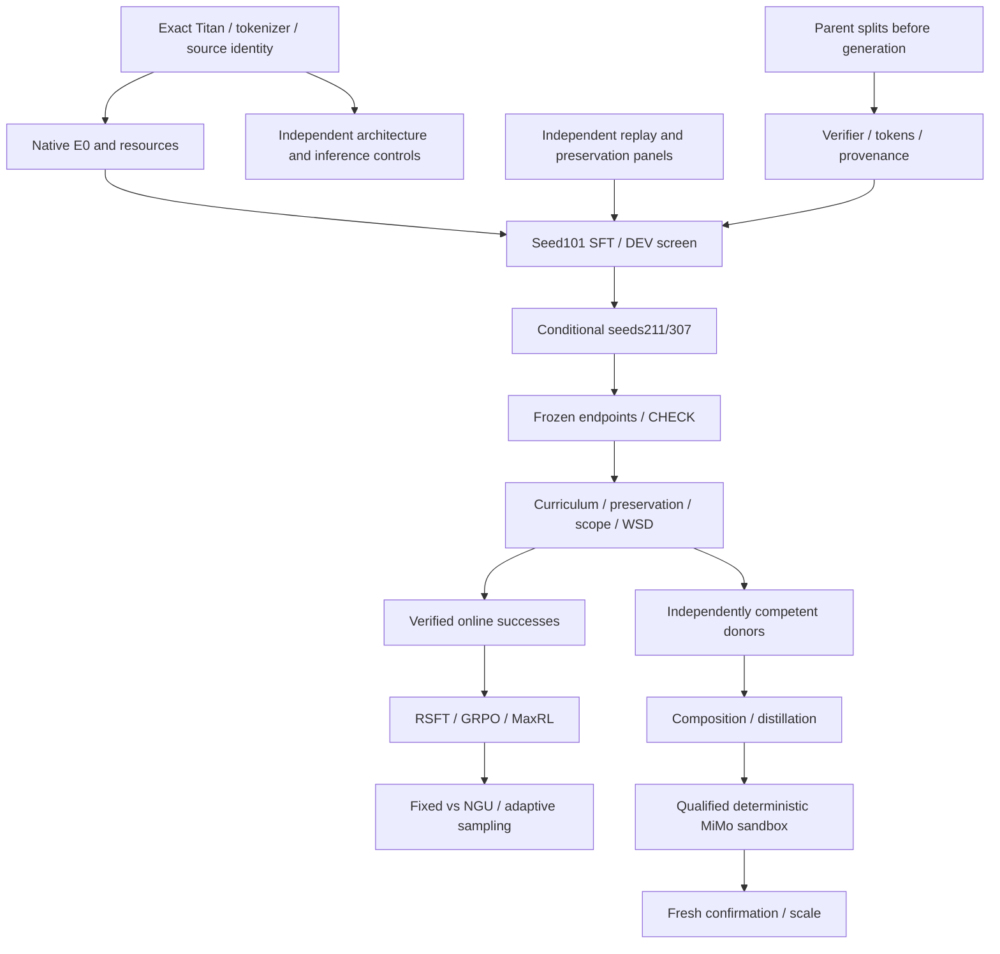

# Dependencies

GFlowRL additionally requires canonical reward-maximizing R0, reference/behavior
likelihood and reward support. LoopSpec additionally requires a useful looped model.
No side-track changes enter E1. Each future experiment receives a complete frozen
registration before its own native run; names here are not launch authorizations.
