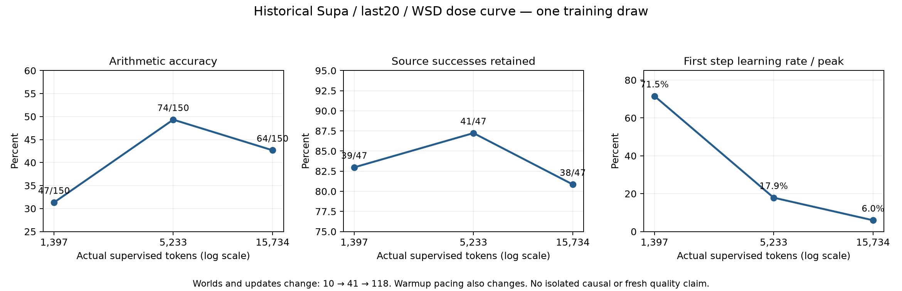
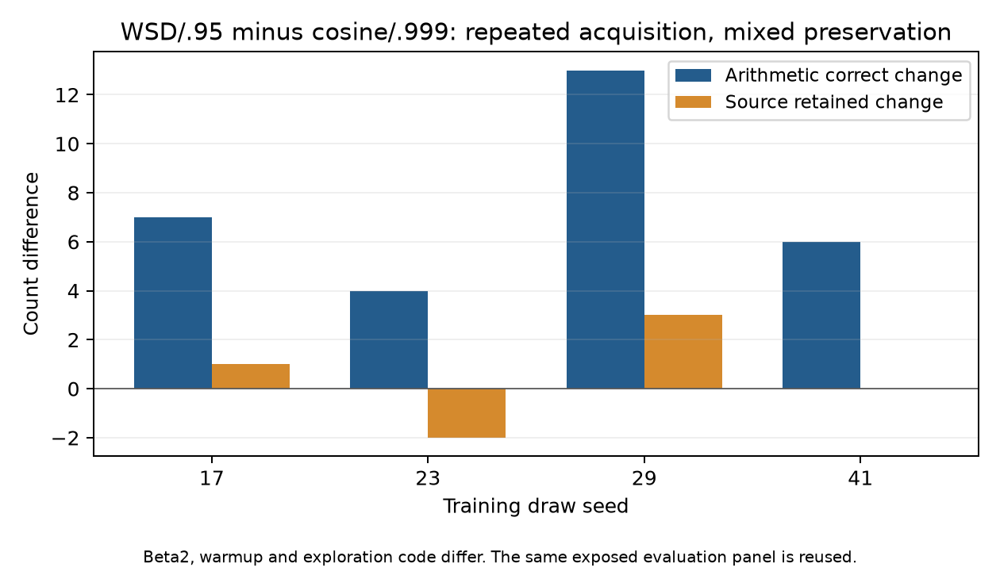

# RQSFT-001 reviewed publication — 2026-10-09

This archive preserves the implementation and selected evidence from this chat.
**No native Rineya qualification, training result or model-quality gain is established.**

The [manifest](manifest.json) binds every published record to both its original
raw-file hash and its exported hash. JSON files wrap sanitized historical content;
XML hostnames and local paths are removed. These exports are not executable packets,
admission reviews or permits. Original local records and historical Git identities
remain preserved. The earlier source/checkout identities require fresh qualification
before any future native work; publication changes cannot inherit a prior permit.

Publication verification: **153 CPU fixtures passed**, zero failures/errors/skips,
one profiler warning. This does not qualify the actual checkpoint or certify resources.

## Findings and limits

- The historical middle dose improves both acquisition and preservation relative to the lower and higher doses. Coverage, updates, warmup, optimizer settings and evaluation harness differ, so the observations do not isolate dose.
- Response-focused supervision improves historical scores on 51 cases across three orderings of one bank. These are not independent training draws or balanced-quality confirmation.
- Formatting, solving and semantic versus literal abstention remain separate measurements. Depth and task family reverse alignment signs in compressed students; these findings do not establish 0.6B SFT gains.
- Handwritten gradient and ideal Adam examples separate direction from scale. Abstract affine witnesses show commutativity and downstream erasure counterexamples. No native gradients were measured.
- The first native proposal remains frozen source versus whole-sequence and final-response-plus-EOS SFT, with 200 TRAIN and 512 DEV rows. Each trained arm has at most 25,000 processed tokens and 32 updates, with independent preservation, transfer and communication gates.
- The October 5 completion audit remained blocked on owner admission, native qualification and outcomes. This publication makes no current claim about the external owner or GPU state.
- Publication review fixes only intermediate overflow in the FP64 ideal first-step Adam helper; the native recipe and optimizer are unchanged.

## Verification and retained records

- [Publication test results](records/2026-10-09-tests.xml)
- [Publication test log](records/2026-10-09-tests.log)
- [Historical October 5 test results](records/20261005-tests.xml)
- [Historical October 5 verification](records/20261005-verification.json)

Historical snapshots refer to the October 5 observations. They are not a current
claim about another owner's pipeline, resource availability, or subsequent work.
This publication changes no serving policy, source weights, data admission or
experimental recipe and launches no model job.

## Historical aggregate figures

