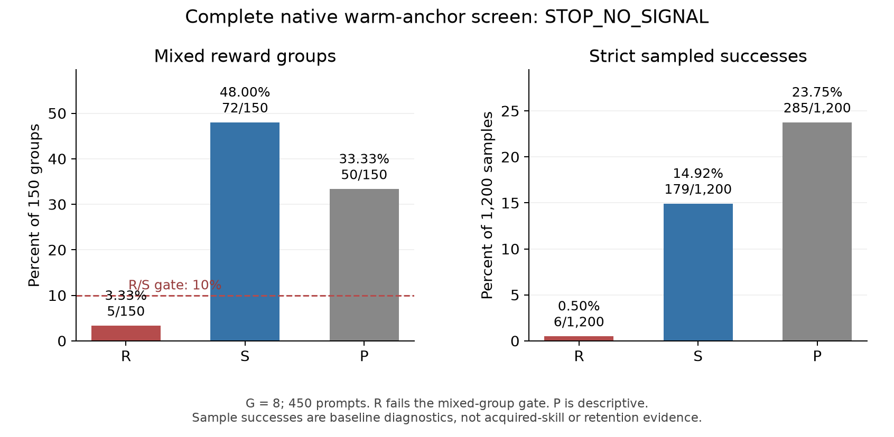

# Skill acquisition method lab

This lab extends the R/S study with primary-paper mathematics, exact toy
enumeration, and a staged combination/permutation design. It does not issue a
training grant or claim native skill acquisition. The original source screen
had 0/3,600 strict successes. The common warm-start completed 600 rows and 75
updates; its full 450-prompt competence read ended **STOP_NO_SIGNAL** because R
had 5/150 mixed groups, below the required 15. The original study path stops.

- [Mathematical analysis](MATHEMATICAL_ANALYSIS.md): original derivations,
  assumptions, primary citations, and controls for each proposed combination.
- [Design matrix](DESIGN_MATRIX.json): primary objective/donor/composition/order
  panels, then conditional sampler, retention, Fisher and teacher follow-ups.
- [Measured warm/C geometry](evidence/MEASURED_GEOMETRY_20260930.json): streamed
  parameter statistics, row-coordinate controls, and verified output bindings.
- [Completed warm competence receipt](evidence/NATIVE_WARM_COMPETENCE_20261001.json):
  R/S/P strict successes 6/179/285 out of 1,200 samples each; full gate and canaries.
- [New oracle-supervision proposal](R_ORACLE_SUPERVISION_PROPOSAL.md): unapproved
  separate experiment with 3,000 verified R TRAIN labels and matched token census.
- [Exact audit](evidence/exact-20260930-v2/EXACT_AUDIT.json): 572 finite-group cases,
  72 bounded stopping cases, and quadratic, covariance, LoRA and Fisher controls.
- [Audit receipt](evidence/exact-20260930-v2/RECEIPT.json): code/output hashes.
- [Scientific figure PDF](evidence/exact-20260930-v2/method_mechanics.pdf).




Version2 adds a boundary check: a fixed mixed-group quota cannot finish for a
positive-weight prompt with p=0 or p=1. Global rejection can still accept other
prompts. Version1's interior-probability tables remain preserved unchanged.

## Reproduce

Use the repository root. The exact audit is standard-library only; tests use
pytest. New output directories are required, so existing receipts are retained.

```powershell
& 'C:/Users/clclc/BusinessProject/.venv-mq001/Scripts/python.exe' -m pytest -q experiments/skill_acquisition_method_lab_v1/tests
& 'C:/Users/clclc/BusinessProject/.venv-mq001/Scripts/python.exe' -m experiments.skill_acquisition_method_lab_v1.run_audit --out /new/output/directory
```

The figure uses the existing Hermes Python environment's matplotlib/numpy,
separate from the native training environment:

```powershell
& 'C:/Users/clclc/AppData/Local/hermes/hermes-agent/venv/Scripts/python.exe' -m experiments.skill_acquisition_method_lab_v1.plot_audit --out /the/audit/output/directory
```

The tests prove the identities for the stated scalar/quadratic examples. They
do not measure a language model's gradient noise, optimizer response, meaningful
acquisition, or retention. Larger gradient magnitude in the figure does not
mean a superior recipe: learning rates, clipping, compute and evaluation remain
controlled native treatment variables.

## Measured warm/C geometry

The completed warm update has 154 tensors in blocks 14–27. The historical C
endpoint contains 220 tensors in blocks 8–27. Subtracting the original Supa
weights from that endpoint gives a historical update; it does not make C a
donor trained from the new warm anchor.

| Quantity | Measured value |
| --- | ---: |
| Cosine on the 154 shared tensors | 0.03600765 |
| Cosine on all 220 tensors, with warm zero-extended | 0.03041138 |
| C squared norm outside warm's support | 28.6683% |
| Warm update norm | 1.27823836 |
| Historical C update norm on all 220 tensors | 0.85751717 |

The two declared FP32/F64 arithmetic conventions agree closely. Support alone
explains part of the difference between the two cosine values: if warm has no
components outside the shared support, then

\[
\cos_{\mathrm{full}}=
\cos_{\mathrm{shared}}\frac{\|\delta_{C,\mathrm{shared}}\|}{\|\delta_C\|}.
\]

This factor is about 0.84458 here. It is not additional evidence that two
functional skills are independent.

Top-16 squared row-energy sets were compared for 28 shared attention/MLP
writeout matrices. Across 14 same-layer attention pairs there were five shared
selected rows; across 14 MLP pairs there were two. The uniform coordinate toy
null expects 3.5 per family, or seven in total. The actual total is also seven.
Attention and MLP have different descriptive same-layer/off-layer patterns;
the dependent cross-layer pairs are not independent statistical replicates.
Three global warm-row permutations preserve within-warm structure while
relabeling its coordinates. They are artificial coordinate controls.

These analyses loaded no native model and ran no GPU inference. Low Euclidean
cosine and row overlap establish parameter geometry. Functional acquisition,
composition and retention still require the registered native evaluations.
