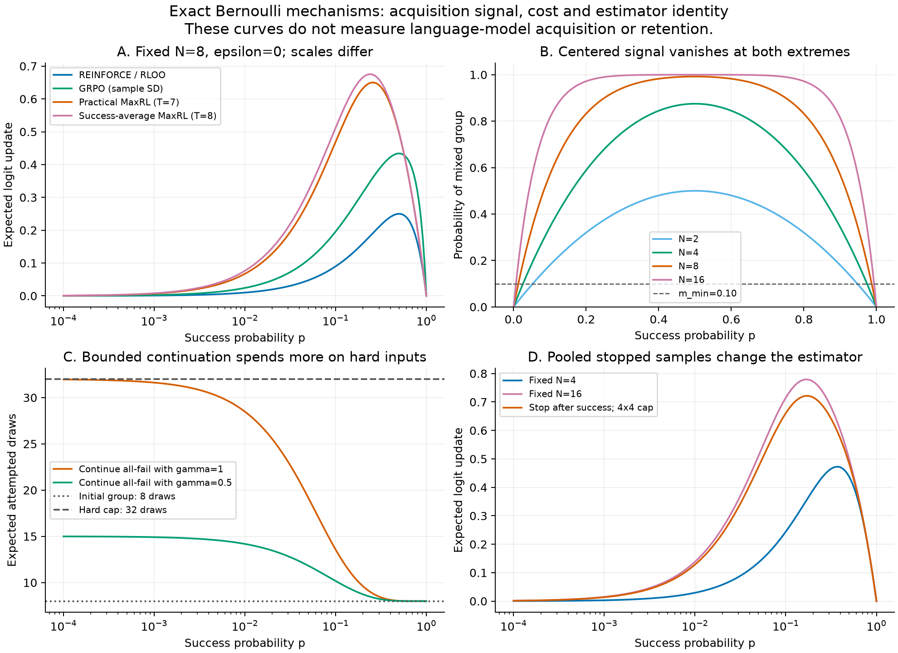

# Skill acquisition method lab

This lab extends the R/S study with primary-paper mathematics, exact toy
enumeration, and a staged combination/permutation design. It does not issue a
training grant or claim native skill acquisition. The full source screen is
0/3,600 strict successes; the registered common warm-start remains the next
native signal gate.

- [Mathematical analysis](MATHEMATICAL_ANALYSIS.md): original derivations,
  assumptions, primary citations, and controls for each proposed combination.
- [Design matrix](DESIGN_MATRIX.json): primary objective/donor/composition/order
  panels, then conditional sampler, retention, Fisher and teacher follow-ups.
- [Exact audit](evidence/exact-20260930/EXACT_AUDIT.json): 572 finite-group cases,
  72 bounded stopping cases, and quadratic, covariance, LoRA and Fisher controls.
- [Audit receipt](evidence/exact-20260930/RECEIPT.json): code/output hashes.
- [Scientific figure PDF](evidence/exact-20260930/method_mechanics.pdf).



## Reproduce

Use the repository root. The exact audit is standard-library only; tests use
pytest. New output directories are required, so existing receipts are retained.

```powershell
& 'C:/Users/clclc/BusinessProject/.venv-mq001/Scripts/python.exe' -m pytest -q experiments/skill_acquisition_method_lab_v1/tests
& 'C:/Users/clclc/BusinessProject/.venv-mq001/Scripts/python.exe' -m experiments.skill_acquisition_method_lab_v1.run_audit --out /new/output/directory
```

The figure uses the existing Hermes Python environment's matplotlib/numpy,
separate from the native training environment:

```powershell
& 'C:/Users/clclc/AppData/Local/hermes/hermes-agent/venv/Scripts/python.exe' -m experiments.skill_acquisition_method_lab_v1.plot_audit --out /the/audit/output/directory
```

The tests prove the identities for the stated scalar/quadratic examples. They
do not measure a language model's gradient noise, optimizer response, meaningful
acquisition, or retention. Larger gradient magnitude in the figure does not
mean a superior recipe: learning rates, clipping, compute and evaluation remain
controlled native treatment variables.
