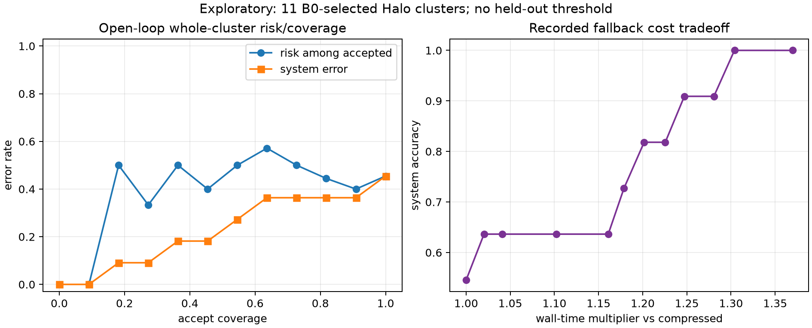

# Architecture Experiment E — Significance-Controlled Recovery

## Result

The bounded recovery architecture is mechanically valid but the first fixed
Cornerstone-only risk score is **not predictive enough to support a controller
quality claim**.

- The deterministic open-loop screen used 11 whole, independent Halo clusters.
- Compressed true-count B3 was correct on 6/11; the previously recorded
  full-cache reference was correct on 11/11 by construction.
- The fixed answer-blind risk score had descriptive compressed-error ROC AUC
  **0.50**. It ranked errors no better than chance on this selected sample.
- A two-case live Halo smoke nevertheless proved both runtime branches:
  accepting leaves the compressed output literally untouched and invokes no
  recomputation; recovering discards the compressed cache, restores every
  source token in a new full cache starting at absolute position zero, and
  recomputes once.

Classification: **NO_MEASURABLE_GAIN** for the deterministic risk signal;
**SUPPORTED** only for the controller/recomputation mechanism.

No learned controller, broad quality improvement, deployment threshold, or
latency advantage is claimed.

## Non-oracle signal

The controller consumes six values derived solely from the final available
pre-answer Cornerstone state:

1. normalized entropy of `S/C`;
2. one minus top-10% mass;
3. one minus the bounded selected/evicted cutoff margin;
4. retained semantic-entry Jaccard churn from the prior boundary;
5. bounded coefficient of variation of true persistent `C`;
6. one minus the latest query-score fraction.

The query-score fraction does not need answer text, evidence labels, or a
second model pass. In this query-conditioned source run, ordinary context
chunks were not score-recorded. Aligning persistent semantic `entry_id` values
between adjacent boundaries therefore makes the nonnegative difference in
cumulative `S` exactly the latest temporary-query contribution for surviving
entries; new entries have a zero prior accumulator.

All six risk components are bounded to `[0, 1]` and equally weighted. The
weights were fixed without fitting outcomes. The durable
`features.pre_answer.jsonl` file was written and leakage-checked before either
answer-bearing `cases.jsonl` file was opened.

## Open-loop whole-cluster screen

Source: the `true_realized_count` condition from
`halo_count_causal_controls_v2`. Every unique risk score is swept as a tie-safe
threshold. A cluster is indivisible: the cluster recovers if any of its cases
crosses the threshold, and no threshold may split a risk tie.

| Measure | Result |
|---|---:|
| Independent clusters | 11 |
| Families | R1, R3, R4 |
| Compressed correct | 6/11 |
| Full-cache reference correct | 11/11 |
| Descriptive error ROC AUC | 0.50 |
| Risk range | 0.516214–0.536316 |
| Tie-safe curve points | 12 |
| Recorded compressed baseline wall time (chunk 128) | 49.1401 s |
| Recover-all combined wall time | 67.3022 s |
| Recover-all wall multiplier | 1.3696× |
| Recover-all input-token bytes | 40,176 B |
| Recover-all sequential peak persistent state | 58,949,632 B |
| Incremental peak over compressed paths | 27,973,120 B |

The top-risk cluster happened to be a compressed error, so recovering only
that cluster changes the replayed system score from 6/11 to 7/11 at a recorded
1.020× wall multiplier. This is a descriptive resubstitution point, not a
selected operating point or a generalization result. Across the entire
ordering, the AUC of 0.50 is the more important finding.



The curve is `OPEN_LOOP TRACE SIMULATION`: the compressed outcome and
same-prompt full-cache outcome already exist. It assumes that invoking the
fallback would reproduce that recorded full-cache path, and adds its recorded
wall time. The cost comparison is not schedule-matched: the compressed source
uses chunk 128 while the prior full-cache run uses chunk 256. It is therefore
an accounting illustration, not a latency comparison, and does not claim
replay equivalence for a gate that changes earlier hidden states.

## Live closed-loop Halo mechanism smoke

The smoke chooses the minimum- and maximum-risk cases using only the durable
pre-answer feature view. A threshold at their midpoint forces one accept and
one recovery action. Both decisions occur after compressed prefill and before
any answer token is decoded.

| Path | Case | Verified behavior |
|---|---|---|
| Accept | `R1-s000116-d050` | exact live/saved risk; zero recomputation calls; literal payload identity; prediction exactly matches the prior compressed run |
| Full recovery | `R3-s000202-d050` | exact live/saved risk; one recomputation; fresh empty cache; no compressed-cache reuse; all source tokens restored; positions contiguous from zero; prediction exactly matches prior full cache |

The live full-cache action took 1.3832 seconds after the compressed prefill,
materialized 58,720,256 bytes of context K/V, and reread 4,096 bytes of int64
input-token IDs. These are mechanism-smoke measurements on one case, not a
stable CPU latency estimate.

The smoke never opens an answer/evidence file and does not score quality. Its
scope is limited to branch identity, context restoration, position safety, and
resource accounting.

## Selection bias and inferential limits

The open-loop curve has several explicit selection effects:

- all 11 clusters were selected because Halo B0 was already correct;
- R2 benchmark-family cases are absent because their B0 gate was 0/8;
- included families contribute at most four clusters at one evidence depth;
- the same 11 clusters supply both risk scores and outcomes;
- each selected cluster contributes one case, so cluster-safe aggregation is
  structurally enforced but numerically identical to case-level aggregation;
- there is no held-out calibration or evaluation split;
- full-cache outcomes and costs are reused from a prior same-prompt run with a
  different prefill chunk size;
- the six-feature weights and transformations are one fixed engineering choice,
  not a validated sufficient statistic for recovery need.

The result therefore says only that this particular deterministic
Cornerstone-state score failed its first small screen. It does not establish
that Cornerstone state can never predict recovery need. A next attempt would
need a larger, capability-conditioned dataset with a frozen calibration split,
family-balanced evaluation, and a prespecified threshold. Until then, the
correct decision is to retain the modular controller API while terminating
quality claims for v1.

## Artifacts and reproduction

- Config: `configs/halo_recovery_controller.yaml`
- Pure controller interface: `src/rineya_significance_lab/recovery.py`
- Risk extraction and whole-cluster curves:
  `src/rineya_significance_lab/evaluation/recovery.py`
- Open-loop run: `results/runs/halo_recovery_controller_screen_v1/`
- Live smoke: `results/runs/halo_recovery_controller_smoke_v1/`

Run the Tier-A screen:

```powershell
uv run --extra analysis python scripts/run_halo_recovery_screen.py
```

Run the Tier-B smoke from an environment containing the declared `model`
dependencies:

```powershell
python scripts/run_halo_recovery_smoke.py
```

Both run directories contain resolved configuration, manifests, summaries,
and SHA-256 content manifests. The screen additionally contains the durable
pre-answer features, scored post-freeze join, machine-readable/CSV curves, and
figure; the smoke contains per-path unscored diagnostics.

## Learned follow-up

Experiment F reused the durable pre-answer feature view under a frozen no-retry
5/3/3 whole-cluster split. Its seven-parameter logistic controller was perfect
on only three held-out clusters/two positive-negative pairs and is classified
`UNDERPOWERED_OVERFIT_SCREEN_ONLY`; it does not rescue the v1 risk claim or
establish Finding D. See [TINY_CONTROLLER_REPORT.md](TINY_CONTROLLER_REPORT.md).
