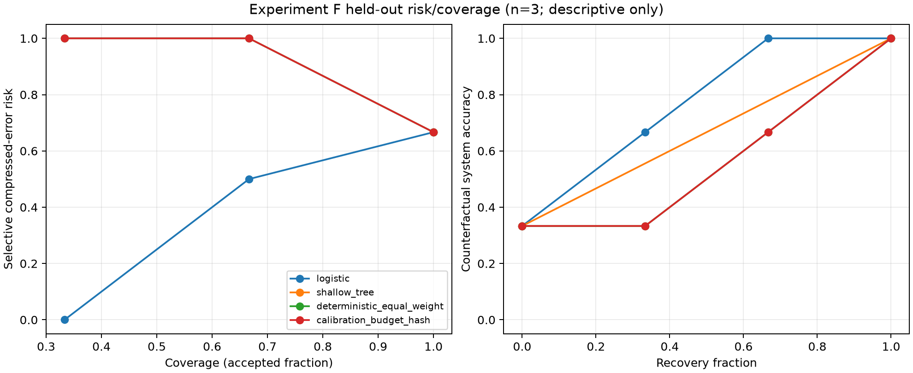

# Architecture Experiment F — Tiny Learned Significance Controller

## Result

A seven-parameter logistic controller perfectly separated the **three** frozen
evaluation clusters, but this is an **underpowered, high-overfit-risk screen**,
not evidence that Cornerstone state supports a reusable learned controller.

- Logistic held-out error ROC AUC: **1.00**.
- Logistic held-out balanced accuracy: **1.00**.
- It recovered both compressed errors, accepted the one compressed success,
  and therefore reached counterfactual system accuracy 3/3 at 1/3 coverage.
- The deterministic equal-weight score and label-blind hash-budget control each
  had AUC **0.00** and balanced accuracy **0.25** at the same two-recovery
  budget.
- The depth-two CART control selected no recoveries and reduced to accept-all
  behavior on evaluation: AUC **0.50**, balanced accuracy **0.50**.

The apparent logistic gain is maximally fragile. Evaluation contains two
compressed errors and one success, so AUC 1.00 represents only **two
positive–negative pairwise comparisons**. Calibration contains three clusters;
training contains five. No inferential test or architecture finding is claimed.

Classification: **UNDERPOWERED / HIGH OVERFIT RISK / SCREEN ONLY**.

## Leakage-safe design

The controller consumes the already durable six-feature rows from
`halo_recovery_controller_screen_v1`:

1. normalized significance entropy;
2. one minus top-mass concentration;
3. one minus selected/evicted cutoff-margin strength;
4. retained-set churn;
5. bounded true-count dispersion;
6. one minus the latest query-score fraction.

These values existed before answer decoding and contain neither answer outcomes
nor oracle evidence annotations. Experiment F copied and revalidated that view,
then assigned whole clusters by one fixed SHA-256 rank:

| Partition | Count | Compressed successes | Compressed errors |
|---|---:|---:|---:|
| Train | 5 | 3 | 2 |
| Calibration | 3 | 2 | 1 |
| Evaluation | 3 | 1 | 2 |

The salt and exact 5/3/3 counts were frozen without accepting labels. Both the
feature snapshot and split map were atomically written and synced before the
answer-derived outcome file was opened. After the join, a mandatory check
verified that every split contained both classes. The implementation has no
alternate-salt search, stratification, or reassignment path: absent class
support raises an error and terminates the run.

The evaluation class-support check necessarily observes whether both held-out
classes exist, as the protocol requires, but evaluation outcomes never enter
feature standardization, fitting, calibration, threshold selection, or the
hash-budget decision rule.

## Models and calibration

The primary controller is class-balanced L2 logistic regression fitted with
deterministic damped Newton/IRLS. The six coefficients and intercept are the
only seven trainable parameters. Feature mean and scale are fitted on the five
training clusters only. Cutoff margin had zero training variance and therefore
received a zero coefficient; the fitted separation effectively rests on five
varying features.

The control is deterministic CART with maximum depth two, exhaustive Gini
split search, deterministic ties, and Laplace-smoothed leaf scores. It fit one
split—four learned scalar/discrete values—and visibly overfit: training balanced
accuracy was 1.00 at the calibrated threshold, while held-out balanced accuracy
was 0.50.

Thresholds were selected only on the three calibration clusters by maximum
balanced accuracy, then fewer recoveries, then higher threshold:

| Method | Calibration threshold | Calibration balanced accuracy | Calibration recoveries |
|---|---:|---:|---:|
| Logistic | 0.477104 | 0.75 | 2/3 |
| Shallow tree | 0.20000000000000004 | 0.50 | 0/3 |
| Equal-weight score | 0.527215 | 0.50 | 0/3 |

The hash-budget baseline receives the logistic calibration recovery fraction,
which fixes two evaluation recoveries, but ranks clusters using a separate
salted hash with no features or labels.

## Held-out comparison

The positive class is “compressed path fails,” and the positive action is
full-cache recomputation.

| Method | AUC | Balanced accuracy | Coverage | Selective risk | System accuracy | Recoveries | Recorded wall multiplier |
|---|---:|---:|---:|---:|---:|---:|---:|
| Logistic | 1.00 | 1.00 | 0.333 | 0.00 | 1.00 | 2/3 | 1.172× |
| Shallow tree | 0.50 | 0.50 | 1.000 | 0.667 | 0.333 | 0/3 | 1.000× |
| Equal-weight Cornerstone score | 0.00 | 0.25 | 0.333 | 1.00 | 0.667 | 2/3 | 1.317× |
| Calibration-budget hash | 0.00 | 0.25 | 0.333 | 1.00 | 0.667 | 2/3 | 1.312× |
| Accept all | 0.50 | 0.50 | 1.000 | 0.667 | 0.333 | 0/3 | 1.000× |
| Recover all | 0.50 | 0.50 | 0.000 | — | 1.00 | 3/3 | 1.400× |

The wall multipliers reuse prior per-prompt compressed and full-cache timings.
Those source paths used different chunk schedules, so this is accounting—not a
contemporaneous latency benchmark. The logistic controller itself took about
56 microseconds for one vectorized three-row call, below stable benchmark
resolution.



## Tier-C resource record

| Component | Learned size | Optimizer | Fit wall time | Sampled peak process RSS | Sampled incremental RSS | Python allocation peak |
|---|---:|---|---:|---:|---:|---:|
| Logistic | 7 parameters | damped Newton/IRLS | 0.00159 s | 49,217,536 B | 1,363,968 B | 12,170 B |
| CART control | 4 learned scalars/discrete values | exhaustive Gini search | 0.02270 s | 49,217,536 B | 983,040 B | 1,019,399 B |

The backbone was not loaded and has zero trainable parameters. Logistic
optimizer state is transient: a seven-value gradient, 7×7 Hessian, and
seven-value Newton step, analytically 504 bytes excluding the design matrix and
predictions. No optimizer state is persisted after fitting. The RSS figures
are sampled and allocator-sensitive; process-lifetime peak includes imports,
while `tracemalloc` excludes native NumPy allocations.

## Interpretation

This result is interesting enough to preserve, but not to advance as a finding:

- the logistic ordering differs materially from the equal-weight score on this
  frozen split;
- the perfect held-out result can arise from a lucky ordering of only three
  cases;
- one of six features is constant in training;
- the tree's train-to-evaluation collapse demonstrates how easily these five
  training rows can overfit;
- all 11 clusters were preselected for B0 capability, exclude benchmark family
  R2, use one evidence depth, and come from the same earlier exploratory run;
- a threshold selected on three calibration clusters is not stable enough for
  deployment.

Therefore Finding D—“a tiny controller can use Cornerstone state to determine
when recomputation is necessary”—remains **unestablished**. The next learned
screen needs a materially larger, prospectively split, capability-conditioned
dataset with family/depth diversity. The present controller and leakage guard
are suitable machinery for that run.

No additional live Halo run was performed. Experiment E already proved both
controller actions against the live runtime; Experiment F changes only the
pre-answer decision score, so repeating the expensive branch-wiring smoke would
add no new mechanism evidence.

## Artifacts and reproduction

- Config: `configs/halo_tiny_significance_controller.yaml`
- Pure controller primitives:
  `src/rineya_significance_lab/evaluation/tiny_controller.py`
- Runner: `scripts/run_halo_tiny_controller.py`
- Run: `results/experiment_f/halo_tiny_controller_v1/`
- Access-order proof: `prelabel_freeze.json` and `data_access_ledger.json`
- Models/resources: `models.json` and `training_resources.json`
- Held-out metrics: `metrics.json`
- Machine-readable summary: `summary.json`

Run on CPU:

```powershell
uv run --extra analysis python scripts/run_halo_tiny_controller.py
```
